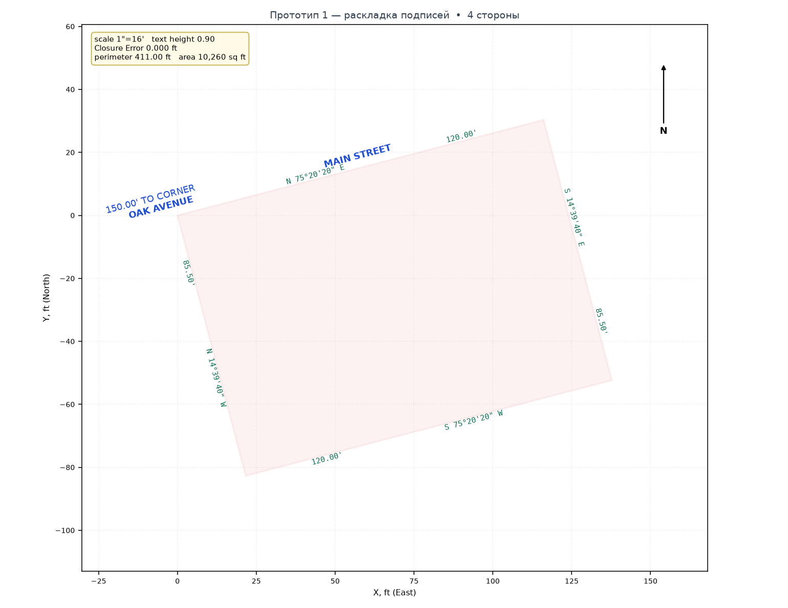

# Title Survey AI (v1.0.0)

Автоматизация геодезических чертежей (**Title Survey / NYC Metes & Bounds**, США):
**Legal Description, скан/векторный PDF или фотографии старых чертежей (`.jpg/.png/.tif`) →
локальный разбор текста или 1–3 независимых прохода LLM (без самовольной подмены цифр документа!) → автоматическая ревизия каждого участка и сверка границ с соседями →
живой предпросмотр схемы и ведомости → отдельная отрисовка готовой схемы в открытом AutoCAD**.

Приложение закрывает полный рабочий сценарий геодезиста: вставили текст описания
(или загрузили PDF / связку фотографий бумажного чертежа 80-х годов в любой ориентации) →
проверили исходник, диагностику подозрительности самого участка, живую векторную схему и акт сверки с соседними лотами →
в активном DWG от перекрёстка `(0.0, 0.0)` строятся отдельные отрезки `LINE`
границы участка, подписи румбов/длин/ремарок вдоль сторон, дуги внутренних углов,
названия фасадной и пересекаемой улиц с привязкой `POB`, а соседние участки
добавляются стенка к стенке в отдельном слое `NEIGHBOR_LOT`.

| Файл | Что делает |
| --- | --- |
| `config.json` | 3 провайдера, настройки Vision и проходов, масштаб, слои и допуски |
| `llm_parser.py` | разбор описаний и изображений, консенсус LLM, поиск опечаток, шифрование ключей |
| `acad_builder.py` | геодезическая математика, диагностика и сверка участков, ActiveX/COM |
| `main.py` | интерфейс Spectrum, источники, проверки и предпросмотр, отрисовка готовых планов |
| `tests/test_prototype1.py` | тесты математики, парсера, консенсуса, сверки и COM-отрисовки |
| `tests/test_gui_smoke.py` | GUI-тесты с заглушками: источники, проверки, пакеты и отрисовка |
| `tests/test_gui_real.py` | настоящие виджеты CustomTkinter и модальные диалоги; нужен дисплей |
| `tests/test_windows_launcher.py` | проверки Windows-запуска и установки в изолированной `.venv` |



*Превью генерируется тем же кодом раскладки: `python docs/make_preview.py
docs/samples/example-1-metes-and-bounds.txt docs/preview-example.png`
(второй пример — `docs/preview-narrow-lot.png`, узкий участок 42.5 × 210 ft,
где подписи сторон растягиваются вдоль длинных линий).*

---

## Ключевые возможности

### 1. Режим 1 / 2 / 3 независимых параллельных проходов LLM и разрешение конфликтов
- Переключатель **«Режим сверки LLM: `1 проход` | `2 прохода` | `3 прохода`»** прямо в панели настроек:
  - При выборе **2** или **3 проходов** раскрываются строки **«Проход #2»** и **«Проход #3»**, где для каждого независимого вызова можно задать любого провайдера и любую модель — как **разные нейросети** (например, `Hydra AI / glm-5.2` + `OpenRouter / nemotron-3.5-super-vl` + `RouterAI / openai/gpt-4.1`), так и **одну и ту же модель** во всех слотах.
  - Чтение/рендер PDF выполняется **один раз**, после чего все 2–3 запроса отправляются **параллельно** (`ThreadPoolExecutor`).
- **Геодезическое сравнение ответов (`compare_legal_descriptions`)**:
  - Не создаёт ложных тревог на косметической разнице (`"Aspenwall St."` vs `"ASPENWALL STREET"`, эквивалентные осевые курсы `"N 0°00' E"` vs `"N 0°00' W"`).
  - Фиксирует любое реальное расхождение: число сторон, румб/угол (до долей секунды и букв `N/S/E/W`), длину стороны (`> 0.005 ft`), внутренний угол, расстояние или румб привязки `POB` от угла улиц, а также названия улиц.
- **Два исхода сверки**:
  - **Полное совпадение (`agreed = True`)** — выводится подтверждение консенсуса `2/2` или `3/3` и рассчитывается схема. Отправка в AutoCAD запускается отдельно.
  - **Расхождение ответов (`agreed = False`)** — отрисовка блокируется, открываются **окно детального сравнения** и **панель конфликта** с перечнем спорных мест и `Closure Error` каждого прохода:
    1. **Решение человеком**: кнопки **`✅ Прав Проход #1 / #2 / #3`** — геодезист сверяется с документом и выбирает результат для схемы.
    2. **Кнопка «🔄 Попробуй разобраться ещё раз»**: по явному нажатию запускает ещё один параллельный раунд тех же моделей с **прицельной инъекцией в промпт** (`build_discrepancy_focus_prompt`) для перепроверки спорных полей и похожих цифр (`3↔8`, `8↔0`, `1↔7`, `5↔6`). Если модели сходятся, конфликт закрывается и обновляется схема. Само нажатие F5 дополнительных запросов не делает.

### 2. Геодезические правила построения границ, невязок и опечаток
- **Отдельные отрезки `LINE` вместо полилинии**: контур основного участка (`PROPERTY_LINE`) и соседних участков (`NEIGHBOR_LOT`) создаётся сразу отдельными объектами `AddLine` (`property_as_lines: true`), без `LWPolyline` и без слепого принудительного замыкания (`Closed = True`) — разбивать полилинию вручную не нужно.
- **Исключение №1 — аналитическое замыкание прямоугольной трапеции с точной перпендикулярной глубиной к улице** (кейс типа `63-01 Borden Avenue`):
  - Когда заданы точный фасад вдоль основной улицы (напр. `20.72'` по `Borden Ave`), перпендикулярная боковая граница строго под `90°` (`AT RIGHT ANGLES`, напр. `90.00'`), параллельная задняя сторона (`PARALLEL WITH`) и точный косой угол (`93°33'29.5"`), а микрогэп вызван округлением косой и задней сторон до сотых фута (`0.01'`), за основу принимаются фасад, перпендикулярная глубина и углы, округлённые стороны уточняются аналитически (`90.17' → 90.1738'`, `26.32' → 26.3164'`), и контур замыкается строго в **`0.0000 ft`** с сохранением паспортных подписей на чертеже и подробным пояснением расчёта в статусе и логе.
- **Исключения №2 и №3 — осмысленный поиск очевидных опечаток с обязательным пояснением**:
  - На уровне промпта LLM (`anomaly_note`) и детерминированного геометрического решателя (`_detect_and_repair_obvious_typos`) проверяются:
    1. **Опечатки направления `N↔S` и `E↔W`** (с проверкой сохранения прямых углов `90°` и невырожденности контура);
    2. **Опечатки цифр в градусах/минутах/секундах углов** (со сверкой с параллельными и перпендикулярными сторонами участка);
    3. **Опечатки визуально похожих цифр в длинах и углах** (`3↔8`, `8↔0`, `1↔7`, `5↔6`, `0↔6`, `0↔9`, `1↔4`, `2↔7` — с приоритетной защитой уличных фасадов).
  - При обнаружении однозначной опечатки строится исправленный контур и **всегда выводится подробное русскоязычное пояснение** (какая сторона, какая буква/цифра исправлена и как изменилась невязка). Неоднозначные расхождения молча не маскируются.
- **Открытый гэп во всех остальных случаях (косоугольные фигуры и неопределяемые расхождения)**:
  - Все $N$ отрезков `LINE` строятся со **100% паспортными длинами и углами**, точка `POB` жёстко стоит от перекрёстка `(0, 0)`, а открытый разрыв выводится:
    - **на рядовом участке** — в правый угол задней стороны (**правый нижний угол**, если дорога сверху листа, и **правый верхний угол**, если дорога снизу листа);
    - **на угловом участке с выходом на две улицы** — строго во **внутренний задний угол (левый или правый), не соприкасающийся ни с одной из двух улиц**, чтобы уличные линии оставались полностью нетронутыми.

### 3. Единая привязка от перекрёстка `(0.0, 0.0)` и режим соседних участков (`Neighbor Lots`)
- Перекрёсток `main_street` × `cross_street` помещается в начало координат `(0.0, 0.0)` WCS.
- Точка `POB (x0, y0)` автоматически откладывается вдоль `corner_to_pob_bearing` на расстояние `distance_to_corner_ft` (в том числе при словесном направлении вроде `distant 420.00 feet easterly from the corner`, где румб привязки автоматически выводится из курса фасадной улицы).
- **Основной участок** рисуется в слоях `PROPERTY_LINE` / `BOUNDARY_TEXT_AI` / `STREET_ROW_AI` со всеми подписями границ, дугами углов и линиями улиц.
- **Соседние участки** добавляются в отдельный слой `NEIGHBOR_LOT` (цвет `4` `acCyan`) без дублирования размеров — только контур из отрезков `LINE` и компактная метка внутри полигона (`"NEIGHBOR (365' from corner)"`). В роли **«Соседний участок»** можно прикрепить несколько PDF сразу; каждый считается отдельным участком, даже если у файлов одинаковый POB. Прикрепление само по себе не запускает разбор, API или AutoCAD.

### 4. Три LLM-провайдера, Vision PDF и аппаратная защита API-ключей
- **Три провайдера с независимыми моделями и ключами**:
  - **Hydra AI** (`https://api.hydraai.ru/v1`, `HYDRA_API_KEY`): `glm-5.2`, `hydra-gemini-pro`, `hydra-gemini-3-pro`, `hydra-gemini` (суффикс `$$` очищается автоматически);
  - **OpenRouter** (`https://openrouter.ai/api/v1`, `OPENROUTER_API_KEY`): `nvidia/nemotron-3.5-super-vl:free`, `nvidia/nemotron-3-super-120b-a12b:free`, `stepfun/step-3.5-flash:free`, `z-ai/glm-4.5-air:free` и др.;
  - **RouterAI** (`https://routerai.ru/api/v1`, `ROUTERAI_API_KEY`): `openai/gpt-4.1`, `openai/gpt-4.1-mini`, `openai/gpt-4o`, `google/gemini-2.5-pro`, `google/gemini-2.5-flash`, `anthropic/claude-sonnet-4.5`, `deepseek/deepseek-chat`.
  В любое поле модели (`CTkComboBox`) можно вписать произвольное имя модели вручную.
- **Текстовые, гибридные и скан/векторные PDF**: если в текстовом слое найдено описание обхода, по умолчанию предлагается **бесплатный локальный разбор** (regex, без API). Кнопка ИИ остаётся доступной и явно предупреждает о расходе токенов. Если найден только чертёж AutoCAD (SHX в кривых или штамп без текста границ) либо скан, выбирается режим Vision; запрос выполняется только после нажатия кнопки разбора. Локальный результат и все размеры необходимо сверять с документом.
- **Шифрование ключей `tsai1:…` от кражи `config.json` и `.env`**: на диск сохраняются только зашифрованные токены `tsai1:…` (аппаратный `MachineGuid` + Windows **DPAPI `CryptProtectData`** + опциональный **PIN-код только в RAM**, `PBKDF2-HMAC-SHA256` 200 000 итераций + `HMAC-SHA256`).
- **Полная поддержка специфики NYC Title Survey**: отделение многозвенных `COMMENCING AT …` привязок от тела участка, предпочтение `(DEED)` перед `(T.M.)`, перевод футов с дюймами (`13 feet 8 inches` → `13.67'`), относительные курсы без румбов (`PARALLEL WITH …`, `AT RIGHT ANGLES TO …`), автоматические дуги внутренних углов (`93°33'29.5"`), двустрочные подписи узких таунхаусов и учёт токенов за вызов и за сессию.

---

## Быстрый старт (Windows)

1. Установите **Python 3.11+** (python.org, с галочкой «Add python.exe to PATH»).
2. Запустите `run.bat` — скрипт создаст виртуальное окружение `.venv`, проверит зависимости и откроет окно программы. В существующем `.venv` он также проверяет и при необходимости устанавливает недостающие зависимости; для их загрузки нужен интернет. Либо вручную:

   ```bat
   py -3.11 -m venv .venv
   .venv\Scripts\python.exe -m pip install -r requirements.txt
   .venv\Scripts\python.exe main.py
   ```

3. Запустите **AutoCAD** и откройте рабочий DWG-чертёж (единицы чертежа — футы).
4. В окне **Title Survey AI** (макет Spectrum, три колонки):
   - при работе с ИИ откройте **`⚙ Настройки`**, введите ключи и выберите модели и **`1 / 2 / 3 прохода`**; для локального разбора ключи не нужны;
   - выберите источник в порядке **`📄 PDF / 📷 Фото / 📝 Текст`**. Перед каждым выбором PDF или фото укажите **«Основной»** или **«Соседний участок»** в диалоге; отмена оставляет прежний ввод без изменений. Для текста роль выбирается переключателем под редактором. Масштаб задаётся в шапке; переключатель **«Поверх окон»** при запуске выключен;
   - нажмите кнопку разбора (**`Ctrl+Enter`**) — появятся ведомость, проверки и схема без AutoCAD. Для подходящего текстового PDF предлагается бесплатный локальный вариант, а ниже — явная кнопка разбора с ИИ. Для скана и фото нужен ИИ/Vision;
   - после основного участка аналогично добавьте соседей: можно выбрать несколько PDF (каждый — отдельный участок) или несколько фотографий **одного** участка. Во вкладке **`🏘 Соседи`** доступны сверка и **`📂 Разобрать файлы…`**; выбор и анализ не чертят автоматически;
   - изучите **`🛡 Проверки`**: замечания формы, предупреждения расчёта и неразрешённые подозрения на опечатки сохранены для всех актуальных фигур с указанием источника. Вкладки проверок и соседей остаются зелёными при успешной проверке, оранжевыми при предупреждении и красными при ошибке, даже когда выбрана другая вкладка; до проверки они нейтральны;
   - нажмите **`▶ Начертить схему в AutoCAD (F5)`**, чтобы отправить в AutoCAD показанные основной участок и соседей. Кнопка **`🏘 Начертить рассчитанных соседей`** отправляет только соседей. Обе используют готовые планы без повторного разбора или запроса к ИИ; при повторном нажатии объекты могут продублироваться;
   - перетащите разделитель между холстом и результатами: правая панель расширяется за счёт холста, а шрифт ведомости, проверок и журнала увеличивается. Двойной щелчок возвращает исходную ширину; после фокусировки разделителя доступны стрелки ←/→;
   - кнопка **`↺ Новый расчёт · полный сброс`** после подтверждения очищает текущие загрузки, схемы, расчёты, счётчики и журнал, но сохраняет ключи и настройки. Файлы на диске и ранее созданные объекты AutoCAD она не удаляет.

**Несколько PDF и страницы.** В смешанном пакете, где хотя бы один файл содержит
распознаваемый текст обхода, сначала предлагается локальный разбор; сканы, которые
он не может прочитать, перечисляются как ошибки. Можно выбрать ИИ явно: тогда он
обрабатывает **все прикреплённые PDF** и может расходовать токены для каждого
файла и каждого выбранного прохода. Для одних только сканов предлагается Vision.
При выборе файлов непосредственно из вкладки сверки роль «Основной» только
загружает источник для последующего разбора; для соседей программа предлагает
локальный вариант для текстовых PDF и запрашивает подтверждение перед обработкой
сканов/фото. Указанный диапазон страниц применяется к каждому PDF: локальный режим читает
текст выбранных страниц, а ИИ при явном диапазоне получает их изображения.
Неудачные файлы и расхождения проходов показываются в статусе/журнале. Неполный
пакет соседей нельзя начертить, даже если переключить источник; при неудачном
повторном разборе прежний план виден, но не считается обновлённым. Повторите разбор
проблемных файлов или очистите соседей (после очистки при необходимости заново
разберите выбранный источник); если PDF не открылся при прикреплении, исправьте
выбор файлов. Для ручного разрешения конфликта повторно откройте
**только спорный PDF или TXT** в роли «Соседний участок»: станет доступен обычный
выбор прохода. Уже рассчитанные соседи остаются на схеме.

**Актуальность и отрисовка.** Если после расчёта изменили текущий текст, роль,
список файлов, страницы или ручной поворот, сначала разберите изменённый источник
заново. После очистки ввода схема остаётся для просмотра, но перед отрисовкой
источник нужно разобрать заново. Разрешите конфликт или сомнение перед отрисовкой; при включённой настройке
«Спрашивать при сомнении» программа также запросит подтверждение для рискованной
геометрии и расхождений с соседями. Масштаб и высота текста берутся из **готового
плана**: чтобы изменить их у конкретного участка, выберите масштаб и повторите его
разбор. При частичной ошибке AutoCAD проверьте уже созданные объекты, прежде чем нажимать F5 снова.

**Сброс во время работы.** Программа игнорирует запоздавшие результаты и не
начинает следующие файлы старого пакета. Но уже отправленный запрос к ИИ и уже
выполняющийся вызов AutoCAD прервать нельзя: запрос может тарифицироваться,
а его расход после сброса не попадёт в обнулённый счётчик. Новое построение
ожидает завершения старого COM-вызова.

Если окно программы не открылось, запустите `run.bat`: при ошибке консоль
останется открытой. Скопируйте её текст; при сбое создания окна также может
появиться файл `%USERPROFILE%\tsai_crash.log`. Перед отправкой сообщения или
журнала удалите из него API-ключи и другие секреты, если они там присутствуют.

---

## Архитектура модулей

### 1. Парсинг, мультипроходный консенсус и автопоиск опечаток (`llm_parser.py`)
- Строгая Pydantic-схема `LegalDescription` / `Segment` с пересчётом канонического `bearing_label` в коде и поддержкой 4 режимов ответа API (`beta.chat.completions.parse` → `json_schema` → `json_object` → `prompt-json` с очисткой `<think>`-блоков).
- `run_multipass_consensus(...)` — параллельный запуск 2–3 независимых `PassTarget`, единое чтение/рендер PDF, агрегация `TokenUsage` и детальный анализ расхождений (`compare_legal_descriptions`).
- `recheck_consensus_discrepancies(...)` — повторный параллельный вызов моделей с инъекцией задания `build_discrepancy_focus_prompt(...)` сосредоточиться на конкретных спорных строках и сверить их с векторным замыканием.
- `_detect_and_repair_obvious_typos(...)` — поиск однозначных опечаток букв `N↔S` / `E↔W`, цифр углов и визуально похожих цифр длин (`3↔8`, `8↔0`, `1↔7`, `5↔6` и др.) с обязательным русскоязычным пояснением.

### 2. Геодезическая математика и COM-построение (`acad_builder.py`)
- Перевод геодезических румбов в WCS AutoCAD (`0° = Север = +Y`, `90° = Восток = +X`), вычисление `compute_pob_point` от перекрёстка `(0.0, 0.0)`.
- `resolve_analytical_right_trapezoid(...)` — аналитическое уточнение округлённых сторон прямоугольной трапеции при известном фасаде, перпендикулярной глубине под `90°` и косом угле.
- `select_gap_vertex_index(...)` и `build_boundary_lines(...)` — построение цепочки из $N$ отдельных отрезков `LineItem` с точными паспортными длинами и углами и выводом неизбежного открытого гэпа в правый задний угол (рядовой лот) либо во внутренний угол вне обеих улиц (угловой лот).
- `AcadBuilder.draw_plan(plan)` отправляет в COM ранее рассчитанный `DrawPlan` без повторного построения геометрии. Отрисовка выполняется в рабочем потоке с автоповтором при `RPC_E_CALL_REJECTED`, переключением из `PaperSpace` в `ModelSpace`, поддержкой SHX/TTF и `ZoomExtents` + `ZoomScaled(0.84, 1)`.

### 3. Графический интерфейс Spectrum Studio v1.0 и интерактивный холст (`main.py`)
- **Трёхколоночный рабочий стол `1440×940` (макет Spectrum), шапка с живым степпером хода работы**:
  - **шапка**: логотип, степпер `1 Источник → 2 Разбор → 3 Проверки → 4 AutoCAD`, масштаб, **`⌨`**, **`⚙ Настройки 🔑 …`** и выключенный при старте переключатель «Поверх окон»;
  - **левая колонка «1 · Исходные данные»**: вкладки **`📄 PDF | 📷 Фото | 📝 Текст`**, выбор роли перед открытием PDF/фото, переключатель роли для текста, страницы и бесплатные повороты. Выбранный способ разбора выделен большой кнопкой; альтернативный доступен ниже. Здесь же расположена кнопка полного сброса;
  - **центр**: шапка с вкладками **`📐 Схема CAD | 🖼 Исходник`**, бейджами `✨ Консенсус N/N` и `Closure … ft`, кнопками копирования и сброса; под ней — баннеры конфликтов проходов LLM и сомнительных мест; сам холст занимает всю глубину;
  - **правая колонка «2 · Результат»**: вкладки **`📋 Ведомость | 🛡 Проверки | 🏘 Соседи | 🧾 Журнал`**, включая кнопку сверки. Цвет вкладок проверок и соседей показывает состояние всей сцены, а карточки проверок сгруппированы по источнику. Разделитель меняет ширину панели (384 px по умолчанию) и масштаб её текстов;
  - **футер**: строка статуса, **`🏘 Начертить рассчитанных соседей`** и **`▶ Начертить схему в AutoCAD (F5)`**. Это отрисовка уже рассчитанных планов, без запроса к ИИ.
- **Выносной ящик настроек (слидер справа на весь экран с затемнением сцены)** — по клику «⚙ Настройки» или ⌘`Src`: API-ключи всех трёх провайдеров (Gemini / GPT / DeepSeek, статус `задан/env —`), аппаратный PIN-сейф с генерацией и стиранием ключа, блок ИИ-движка (переключатели ИИ-разбора и числа проходов `1 / 2+прозр. / 3`, визуальные слоты **Проход #1/#2/#3** с точными целевыми моделями, «☑ Спрашивать при сомнении») и кнопка «Защитить в .env»/«💾 Сохранить (Ctrl+S)».
- **Горячие клавиши повседневной работы и буфер обмена**:
  - **`Ctrl + Enter`** — разбор и схема (parse); **`F5`** — рисование в AutoCAD; **`Ctrl + O/I/S`** — PDF/Фото/Сохранить; памятка клавиш — кнопка **`⌨`**;
  - **«📋 Копировать» в шапке результата** копирует **техведомость** участка: оформленный шаблон с невязкой, площадью, периметром, привязкой POB к перекрёстку `(0,0)` и полным перечнем сторон (№/румб/длина) — для вставки в отчёт или Акт геодезической сверки.
- **Интерактивный холст предпросмотра (CADVIEW по макету Spectrum)**:
  - тёмный чертёжный фон, минорные/мажорные линии инженерной сетки с координатными подписями по краям, красные пунктиры улиц с светло-голубыми заглавными подписями;
  - вершины-квадратики WCS, круглые бейджи номеров сторон по серединам отрезков (синхронны с ведомостью и hover-подсветкой), янтарный стилизованный POB с кольцом; компасная стрелка на Север и динамическая масштабная линейка;
  - зум колесом `0.6×..10×` (кнопки `+ − 1:1/×N` справа поверх холста), панорама ЛКМ, двойной клик — «вписать»; HUD-координаты мыши и подсветка ближайшей стороны с длиной/румбом — как в прототипе;
  - режим **`🖼 Исходник`**: лупа автоматически повышает разрешение рендера фото (мелкие цифры `54` против `56` различимы под приближением).
- **Наглядное разрешение конфликтов и сомнений** (в баннерах над холстом): карточки проходов с Δ-невязкой каждой модели и построчный diff полей расхождений, кнопки **«Прав проход #k»** и **«Попробуй разобраться ещё раз»**, а при сомнительной опечатке — диалог «осторожно, текст исправить?» с кнопками «Ещё раунд LLM… / Оставить как есть / Применить правку».

### 4. Интеллектуальная сверка с соседними участками (`🔍 Сверка с соседями`)
- Работает как **автоматически** (при добавлении любого соседнего участка в сцену), так и по кнопке **`🔍 Сверка с соседями`** (в том числе **без открытого AutoCAD** — можно выбрать `.txt / .pdf / .jpg / .png / .tif` файлы соседей только для проверки).
- Анализирует общие межевые стены, фасадную привязку к перекрёстку `(0, 0)` и точное 2D-пересечение полигонов, выдавая осмысленный инженерный диагноз каждого расхождения:
  - **разница только в секундах угла** (`40"` против `48"` или `00"`) — детекция ошибок OCR одной цифры (`0↔8`, `6↔9`, `2↔5`) или архивного округления 80-х гг. до целых минут;
  - **опечатки в минутах и градусах** (при полном совпадении остальных разрядов) и **зеркальная путаница квадранта** (`E ↔ W`, `N ↔ S`);
  - **систематический поворот базиса меридиана (`Bearing Basis`)** — когда все стороны соседа дружно повёрнуты на один и тот же угол `Δθ` (съёмки разных эпох: Magnetic North 80-х vs NAD83 / True North);
  - **путаница «дюймы ↔ десятые фута»** (`100'-6" = 100.50'` против ошибочной записи `100.60'`), посимвольные опечатки/перестановки цифр в длинах (`105'` ↔ `150'`, `100'` ↔ `108'`) и ступенчатые примыкания лотов разной глубины;
  - **щели (`Gore / Gap`), клиновидные расхождения (`Wedge`) и наложения границ (`Overlap / Encroachment`)** с точным расчётом площади пересечения в `sq ft` (включая невыпуклые L-участки);
  - **кросс-проверка через собственную невязку (`Closure Attribution`)**: определяет, в чьём именно документе (нашем или соседском) допущена ошибка, сравнивая невязки обоих контуров с вектором расхождения на общей стене.
- Подсвечивает проверенные общие стены (`✓ межа`) и проблемные границы (`⚠ Δ∠ / ΔL`) прямо на векторной схеме `📐 Схема CAD` и формирует копируемый **Акт геодезической сверки с соседями**.

### 5. Автоматическая ревизия подозрительности каждого создаваемого участка (`audit_lot_suspicion`)
- Запускается **автоматически для каждого участка** (как основного, так и соседнего), в том числе когда **`Closure Error = 0.000 ft`**, но сама фигура подозрительна или геометрически противоречива:
  - **контроль суммы внутренних углов `(N − 2) × 180°`**: отлавливает невязку суммы явно заданных углов чертежа (`359°58'30"` вместо `360°00'00"`) и угловое рассогласование разомкнутого хода;
  - **ловушка скошенного «почти прямоугольника» (в т.ч. при `Closure Error = 0.000'`)**: если противоположные стороны попарно равны и параллельны, контур замыкается в ноль, но углы отклоняются от `90°` на секунды/минуты (`89°59'00"` / `90°01'00"` — в том числе классическая ошибка заёма `1'` при вычитании румба из `90°`, когда вычитают минуты из `60'` вместо `59'`);
  - **прямая и обратная теоремы Евклида для четырёхугольников**:
    - стороны попарно равны по длине (`100'/100'` и `55'/55'`), но противоположные румбы не параллельны (с посимвольной подсказкой разрядов DMS);
    - углы образуют строгий прямоугольник или параллелограмм, но парные стороны разной длины (с проверкой путаницы `дюймы ↔ десятые фута` и опечаток цифр);
  - **нарушение теоремы Пифагора у прямоугольной трапеции** и подозрительно «почти параллельные» противоположные межи (`2.5"..45'`);
  - **примитивные геометрические ошибки**: потеря десятичной точки (`10000'` вместо `100.00'`, когда одна сторона длиннее суммы остальных), самопересечение контура («песочные часы»), разворот на `180°` назад («игла»), дубликат подряд идущей стороны, микроизлом прямой линии `~180°`, микросегменты-артефакты, вырожденная «сплющенная» площадь и излом линии фасадной улицы в точке `POB`.
- Сигнализирует геодезисту через цвет вкладки **`🛡 Проверки`**, общий счётчик фигур и замечаний, карточки с источником каждой фигуры, строку статуса и пунктирную подсветку подозрительных сторон `⚠ #k` на схеме. Кнопка счётчика открывает копируемую диагностику всех актуальных фигур; при замене или удалении участка его старые замечания исчезают.

### 6. Защита от самовольной подмены цифр, фокус-проверка зоны внимания и чекбокс «☑ Спрашивать при сомнении»
- **Жёсткое правило дословного чтения (`STRICT VERBATIM RULE`)**: промпты и JSON-схема строго запрещают LLM подменять напечатанные в PDF/скане числа в `segments` ради замыкания (например, превращать реальные `54.00'` в `56.00'`). Любое сомнение модель выносит только в `anomaly_note`.
- **Неприкосновенность консенсуса 2–3 проходов LLM**: каждый проход сравнивается до любых числовых эвристик, а если **2 из 2** или **3 из 3** независимых проходов единогласно прочитали одно и то же число (например `54.00'`), Python **никогда не перезаписывает его** своими правилами опечаток — даже если чекбокс «Спрашивать при сомнении» снят.
- **Чекбокс `☑ Спрашивать при сомнении`** (`ask_on_doubt: true` по умолчанию):
  - **Включён (по умолчанию)**: при подозрении на опечатку (`TypoSuspicion`) во время разбора программа предлагает человеку выбор:
    1. **`🔬 Ещё раунд LLM с фокусом на зону внимания`** (`recheck_typo_suspicion`) — запускает целевой раунд проходов (без повторного рендера PDF/фото) с инъекцией промпта именно на спорную сторону и строгим запретом «подгонять цифру под замыкание, если в документе действительно написано исходное число»;
    2. **`📄 Оставить как в документе`** — сохранить паспортные цифры без правок;
    3. **`✏️ Применить исправление`** — заменить значение только по явному решению геодезиста.
    Перед отрисовкой подозрительного/незамкнутого контура или проблемной сверки отдельно запрашивается подтверждение готовой схемы.
  - **Выключен («больше самостоятельности, но не безумной»)**: работает без всплывающих диалогов, в 1-проходном / regex режиме аккуратно чинит только однозначные визуально похожие OCR-опечатки (`6↔9`, `3↔8`, `5↔6`, `5↔8`, `N↔S`) с русским пояснением, но **никогда** не ломает согласованный ответ 2+ LLM и **никогда** не подменяет визуально непохожие цифры (вроде `54 → 56`, пара `4→6`).

---

## Тесты

```bash
pytest -v
```

`tests/test_gui_real.py` дополнительно проверяет настоящее окно CustomTkinter,
модальный выбор роли, цвета вкладок, панель и основные переключатели. Для него нужен дисплей (на Linux можно
использовать `xvfb-run -a python -m pytest -q tests/test_gui_real.py`); без Tk
или дисплея он пропускается. Для обязательной проверки можно установить
переменную окружения `REQUIRE_REAL_TK=1`: тогда пропуск станет ошибкой.
`tests/test_windows_launcher.py` проверяет запуск `run.bat`, ошибки и установку
в существующее окружение; тесты самого запуска выполняются только на Windows.

Автотесты не требуют установленного AutoCAD или доступа к сети и проверяют:
- геодезическая математика квадрантов, DMS-углов, площади и невязки;
- парсинг классических американских и нью-йоркских описаний (`63-01 Borden Ave`, `147 Dartmouth Loop`, `Jamie Lane`, серия соседних участков `Aspenwall St — 365' / 420' / 475'`, дробные дюймы 1980-х `25'-6 1/2"`);
- построение контура отдельными отрезками `LINE` (`AddLine`), аналитическое замыкание прямоугольной трапеции, защита от самовольной подмены цифр (`54 → 56`), неприкосновенность консенсуса 2+ LLM, фокус-раунд на зону внимания и отведение открытого гэпа;
- автоматическая проверка каждого создаваемого участка на подозрительность (`audit_lot_suspicion`): сумма углов `→ 360°`, скошенный в `0.000'` «почти прямоугольник» (ошибка заёма `1'` из `90°`), прямая и обратная теоремы Евклида, теорема Пифагора для трапеций, потеря десятичной точки, самопересечения, развороты `180°`, дубликаты и излом линии улицы в `POB`;
- интеллектуальная сверка с соседними участками (`verify_with_neighbors`): диагностика секундных/минутных/градусных опечаток, перепутанных квадрантов, поворота базиса меридиана, путаницы футов и дюймов, щелей `Gore`, наложений `Overlap` и виновника по невязке;
- фотоконвейер архивных чертежей 1980-х: смартфонный `EXIF Orientation`, ручной поворот `90° / 180° / 270°`, выбор страниц фото-PDF, разовый `🧭 ИИ-поворот` с предупреждением и сжатие `JPEG 4:4:4`;
- параллельный консенсус 2–3 проходов LLM, геодезическое сравнение ответов, разрешение конфликта человеком и повторный арбитраж по кнопке «Попробуй разобраться ещё раз»;
- шифрование API-ключей `tsai1:…`, Vision-конвейер PDF, пакетная загрузка соседей (`.pdf / .jpg / .txt`), суммарные проверки по источникам и отрисовка готовых планов без повторного вызова ИИ.

## Текущие ограничения

- Дуговые сегменты границ (кривые `curve to the right/left, radius R, arc length L`) аппроксимируются хордой (пока без прямой генерации граничной дуги `AddArc` по радиусу кривой дороги).
