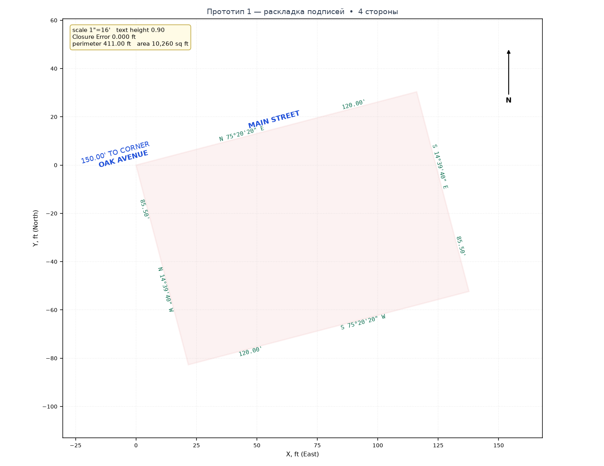

# Title Survey AI (v4.80.2)

> Версия программы одна на всё приложение и задаётся в `version.py`: она стоит в левом верхнем углу
> окна (`v4.80.2 · STUDIO`), в заголовке окна (с датой) и в отчёте Шага 2 (`Версия Шага 2: 4.80.2 (…)`).
> Правила заказчика, по которым работает Шаг 2, и те, что ждут своей очереди, — в
> [docs/customer_rules.md](docs/customer_rules.md).

Автоматизация геодезических чертежей (**Title Survey / NYC Metes & Bounds**, США):
**Legal Description, скан/векторный PDF или фотографии старых чертежей (`.jpg/.png/.tif`) →
локальный разбор текста или 1–3 независимых прохода LLM (без самовольной подмены цифр документа!) → автоматическая ревизия каждого участка и сверка границ с соседями →
живой предпросмотр схемы и ведомости → отдельная отрисовка готовой схемы в открытом AutoCAD**.

Приложение закрывает полный рабочий сценарий геодезиста: вставили текст описания
(или загрузили PDF / связку фотографий бумажного чертежа 80-х годов в любой ориентации) →
проверили исходник, диагностику подозрительности самого участка, живую векторную схему и акт сверки с соседними лотами →
в активном DWG от перекрёстка `(0.0, 0.0)` строятся отдельные отрезки `LINE`
границы участка, подписи румбов/длин/ремарок вдоль сторон, дуги внутренних углов,
названия фасадной и пересекаемой улиц с привязкой `POB`, а соседние участки
добавляются стенка к стенке в отдельном слое `NEIGHBOR_LOT`.

| Файл | Что делает |
| --- | --- |
| `config.json` | 3 провайдера, настройки Vision и проходов, масштаб, слои и допуски; раздел `feature_labeling` — слои, словари и допуски Шага 2 |
| `llm_parser.py` | разбор описаний и изображений, консенсус LLM, поиск опечаток, шифрование ключей |
| `pdf_set.py` | Шаг 1 — набор PDF: наш участок и соседи одним выбором, страницы по каждому файлу (из имени `…_p17` / `…_p2_5` или из полей списка), способ разбора каждого файла |
| `conflict_resolver.py` | Шаг 1 — конфликты между участками набора: чего не хватает в одном описании и что можно взять из описания соседа (правила на Python + ИИ-советник), проверка каждой находки геометрией |
| `acad_builder.py` | геодезическая математика, диагностика и сверка участков, ActiveX/COM; Шаг 2 — чтение чертежа, раскладка и создание подписей в `D-TOPO-TEXT` |
| `feature_labeler.py` | Шаг 2 — распознавание объектов вокруг участка (shapely): заборы, калитки, строения, крыльца, ступени, покрытия; текст подписи по заметкам полевика, кодам точек и именам слоёв |
| `main.py` | интерфейс Spectrum: вкладка «Шаг 1» (источники, проверки, предпросмотр, отрисовка готовых планов) и вкладка «Шаг 2. Автоподписание объектов» |
| `tests/test_prototype1.py` | тесты математики, парсера, консенсуса, сверки и COM-отрисовки |
| `tests/test_gui_smoke.py` | GUI-тесты с заглушками: источники, проверки, пакеты и отрисовка |
| `tests/test_pdf_set.py` | Шаг 1, набор PDF: страницы из имени файла, список с отметкой нашего участка, разбор только выбранных страниц, итог по каждому участку |
| `tests/test_conflict_resolver.py` | Шаг 1, конфликты набора: румб улицы из описания соседа, проверка геометрией, «Применить» / «Вернуть как в документе», ИИ-советник |
| `tests/test_feature_labeling.py` | Шаг 2: распознавание, дедупликация, раскладка подписей и COM-заглушка AutoCAD |
| `tests/test_gui_real.py` | настоящие виджеты CustomTkinter и модальные диалоги; нужен дисплей |
| `tests/test_windows_launcher.py` | проверки Windows-запуска и установки в изолированной `.venv` |



*Превью генерируется тем же кодом раскладки: `python docs/make_preview.py
docs/samples/example-1-metes-and-bounds.txt docs/preview-example.png`
(второй пример — `docs/preview-narrow-lot.png`, узкий участок 42.5 × 210 ft,
где подписи сторон растягиваются вдоль длинных линий).*

---

## Ключевые возможности

В Шаге 1 красные уличные линии не продлеваются крестом через общий угол смежных фасадов углового участка. У рядового участка пересекаемая улица начинается на привязке и идёт только в сторону блока. Геометрия участка не меняется, ранее созданные линии автоматически не удаляются. Подробнее — [правила заказчика](docs/customer_rules.md#шаг-1-красные-линии-у-перекрёстка-474).

В Шаге 1 и печатном черновике размеры в футах и дюймах отображаются через дефис; в смешанном формате целые футы показываются с нулём дюймов, а нецелые десятичные футы остаются десятичными. Порядковые номера улиц получают строчные суффиксы, фронтальная пометка `along` не печатается, а явно указанное `parallel with` стоит ниже длины. Подробности и ограничения — в [правилах заказчика](docs/customer_rules.md#шаг-1-подписи-по-замечаниям-николая-468).

В настройках доступны три темы интерфейса: голубоватая (по умолчанию), лавандовая и серая. Выбор сохраняется в `config.local.json` (`ui.theme`) и применяется после перезапуска, не прерывая текущую работу. Цвета объектов CAD не зависят от темы.

После обновления перезапуск запускает `run.bat` в отдельном cmd с явным завершением; старый процесс закрывается. При успешном запуске `run.bat` закрывает своё окно cmd (в том числе если запущен вручную из уже открытого cmd). Ошибки установки или проверки файлов остаются на экране с возможностью отката.

Автоматически исправленные значения на основном участке отмечаются выноской в AutoCAD: полный румб и длина, изменённые символы красным, острие на стороне. Слой `TSAI-WARNINGS` можно удалить после проверки. Печатный черновик и соседи без этих пометок. Правила и ограничения — в [docs/drawing_warnings.md](docs/drawing_warnings.md).

### 1. Режим 1 / 2 / 3 независимых параллельных проходов LLM и разрешение конфликтов
- Переключатель **«Режим сверки LLM: `1 проход` | `2 прохода` | `3 прохода`»** прямо в панели настроек:
  - При выборе **2** или **3 проходов** раскрываются строки **«Проход #2»** и **«Проход #3»**, где для каждого независимого вызова можно задать любого провайдера и любую модель — как **разные нейросети** (например, `Hydra AI / glm-5.2` + `OpenRouter / nemotron-3.5-super-vl` + `RouterAI / openai/gpt-4.1`), так и **одну и ту же модель** во всех слотах.
  - Чтение/рендер PDF выполняется **один раз**, после чего все 2–3 запроса отправляются **параллельно** (`ThreadPoolExecutor`).
- **Геодезическое сравнение ответов (`compare_legal_descriptions`)**:
  - Не создаёт ложных тревог на косметической разнице (`"Aspenwall St."` vs `"ASPENWALL STREET"`, эквивалентные осевые курсы `"N 0°00' E"` vs `"N 0°00' W"`).
  - Фиксирует любое реальное расхождение: число сторон, румб/угол (до долей секунды и букв `N/S/E/W`), длину стороны (`> 0.005 ft`), внутренний угол, расстояние или румб привязки `POB` от угла улиц, а также названия улиц.
- **Два исхода сверки**:
  - **Полное совпадение (`agreed = True`)** — выводится подтверждение консенсуса `2/2` или `3/3` и рассчитывается схема. Отправка в AutoCAD запускается отдельно.
  - **Явно лучший из двух проходов**: если один корректный контур замкнут с невязкой не более 0.015 ft, а у другого невязка не менее 1 ft, программа автоматически выбирает первый при любом положении «Спрашивать при сомнении». Допускаются только различия в длинах и направлениях сторон; все остальные данные должны совпадать, стороны — иметь прочитанные, а не вычисленные румбы. Это не консенсус: выбор, обе невязки и спорные значения остаются в предупреждениях и журнале. Замыкание не доказывает, что документ прочитан верно; его нужно сверить.
  - **Прочие расхождения (`agreed = False`)** — отрисовка блокируется, открываются **окно детального сравнения** и **панель конфликта** с перечнем спорных мест и `Closure Error` каждого прохода:
    1. **Решение человеком**: кнопки **`✅ Прав Проход #1 / #2 / #3`** — геодезист сверяется с документом и выбирает результат для схемы.
    2. **Кнопка «🔄 Попробуй разобраться ещё раз»**: по явному нажатию запускает ещё один параллельный раунд тех же моделей с **прицельной инъекцией в промпт** (`build_discrepancy_focus_prompt`) для перепроверки спорных полей и похожих цифр (`3↔8`, `8↔0`, `1↔7`, `5↔6`). Если модели сходятся, конфликт закрывается и обновляется схема. Само нажатие F5 дополнительных запросов не делает.

### Скрытая страница разработчика: независимые запросы к ИИ

Трижды быстро нажмите на логотип 📐 или название **Title Survey AI** в левом верхнем углу. Откроется отдельное окно чата: выберите провайдера и модель (название модели можно ввести вручную). Используются API-ключи и PIN из обычных настроек; выбор в чате не меняет рабочую модель разбора.

- Каждый запрос отправляет только текущее сообщение, без предыдущих сообщений, ответов и системного контекста приложения. Переписка отображается только для удобства, не записывается приложением на диск или в журнал и уничтожается при закрытии окна; новая страница начинает пустой диалог.
- Отправка кнопкой или **Ctrl+Enter**, обычный Enter добавляет строку. Видны время и число токенов, если провайдер их вернул. Можно скопировать последний ответ в системный буфер обмена или очистить переписку.
- Очистка во время запроса отбрасывает его будущий ответ; закрытие окна не отменяет уже отправленный сетевой запрос. Скопированный ответ остаётся в буфере обмена по правилам ОС.
- Запросы могут быть платными. Выбранный провайдер получает текст текущего запроса и может хранить его согласно собственной политике — программа не управляет хранением на стороне провайдера.

### 2. Геодезические правила построения границ, невязок и опечаток
- **Отдельные отрезки `LINE` вместо полилинии**: контур основного участка (`PL`) и соседних участков (`NEIGHBOR_LOT`) создаётся сразу отдельными объектами `AddLine` (`property_as_lines: true`), без `LWPolyline` и без слепого принудительного замыкания (`Closed = True`) — разбивать полилинию вручную не нужно.
- **Исключение №1 — аналитическое замыкание прямоугольной трапеции с точной перпендикулярной глубиной к улице** (кейс типа `63-01 Borden Avenue`):
  - Когда заданы точный фасад вдоль основной улицы (напр. `20.72'` по `Borden Ave`), перпендикулярная боковая граница строго под `90°` (`AT RIGHT ANGLES`, напр. `90.00'`), параллельная задняя сторона (`PARALLEL WITH`) и точный косой угол (`93°33'29.5"`), а микрогэп вызван округлением косой и задней сторон до сотых фута (`0.01'`), за основу принимаются фасад, перпендикулярная глубина и углы, округлённые стороны уточняются аналитически (`90.17' → 90.1738'`, `26.32' → 26.3164'`), и контур замыкается строго в **`0.0000 ft`** с сохранением паспортных подписей на чертеже и подробным пояснением расчёта в статусе и логе.
- **Исключения №2 и №3 — осмысленный поиск очевидных опечаток с обязательным пояснением**:
  - На уровне промпта LLM (`anomaly_note`) и детерминированного геометрического решателя (`_detect_and_repair_obvious_typos`) проверяются:
    1. **Опечатки направления `N↔S` и `E↔W`** (с проверкой сохранения прямых углов `90°` и невырожденности контура);
    2. **Опечатки цифр в градусах/минутах/секундах углов** (со сверкой с параллельными и перпендикулярными сторонами участка);
    3. **Опечатки визуально похожих цифр в длинах и углах** (`3↔8`, `8↔0`, `1↔7`, `5↔6`, `0↔6`, `0↔9`, `1↔4`, `2↔7` — с приоритетной защитой уличных фасадов).
  - При обнаружении однозначной опечатки строится исправленный контур и **всегда выводится подробное русскоязычное пояснение** (какая сторона, какая буква/цифра исправлена и как изменилась невязка). Неоднозначные расхождения молча не маскируются.
- **Открытый гэп во всех остальных случаях (косоугольные фигуры и неопределяемые расхождения)**:
  - Все $N$ отрезков `LINE` строятся со **100% паспортными длинами и углами**, точка `POB` жёстко стоит от перекрёстка `(0, 0)`, а открытый разрыв выводится:
    - **на рядовом участке** — в правый угол задней стороны (**правый нижний угол**, если дорога сверху листа, и **правый верхний угол**, если дорога снизу листа);
    - **на угловом участке с выходом на две улицы** — строго во **внутренний задний угол (левый или правый), не соприкасающийся ни с одной из двух улиц**, чтобы уличные линии оставались полностью нетронутыми.

**Граница Шага 1 (4.53).** Нефасадные стороны нашего участка — отдельные зелёные
`LINE` на `PL` (ACI 3), с принудительным типом `Continuous` для каждого нового
отрезка: граница не становится пунктирной из-за настроек слоя. Граница с улицей —
красные `LINE` на `M-ROW-LINE` (ACI 1, тип `ByLayer`); у углового участка
учитываются оба фасада. Существующие цвета и типы слоёв DWG не перезаписываются;
новый `PL` создаётся с типом `Continuous`. Изменение применяется также к границе
печатного черновика, но не переделывает уже созданные объекты. Реальные типы и
отрисовку необходимо проверить в AutoCAD. Геометрический гэп невязки при этом
сохраняется — тип линии не исправляет нестыковку документа.

В печатном черновике промежуток между румбом и расстоянием сокращается; при доступном измерении AutoCAD пробелы дополнительно подбираются так, чтобы ширина строки не превышала 80% стороны. Значения, высота и стиль не меняются. Если не хватает места даже с одним пробелом или не удалось измерить фактическую ширину, результат требует проверки. Реальный стиль `LETTER` в AutoCAD ещё не проверен.

При «Начертить» автоматически строится **один черновик для печати**: контур
нашего участка точно на +1000 единиц по X в WCS, на тех же слоях и с теми же
цветами. Если есть линия привязки к перекрёстку, она имеет в черновике 40 футов:
для этого перемещается перекрёсток черновика, а не участок. В него входят также
линии улиц, подписи сторон, названия улиц и оригинальное расстояние до перекрёстка
из legal description, но не соседи. Для обычного участка линия пересекаемой улицы
идёт от перекрёстка в сторону участка на 100 ft под прямым углом к привязке, без
продолжения через неё. Это условная геометрия черновика. Надпись `PARTY WALL`,
если она относится к стороне описания, выводится отдельной строкой внутри участка;
длинную фразу `PART OF THE DISTANCE THROUGH A PARTY WALL` не печатаем. Если сторона
или привязка записаны в legal description в футах и дюймах, их подпись сохраняется
в этом формате (в том числе с дробными дюймами), а геометрия считается в футах.
Старое название пересекаемой улицы выводится в скобках, если явно указано в исходнике.
Подписи границ и названия улиц основного плана и черновика — в `M-TAX-DIM`, стиль `LETTER`.
Высоты черновика: улицы 4, румбы и размеры 2, остальные тексты 1.6. Если `LETTER`
есть в DWG, программа использует его без изменения. Если нет — создаёт с запасным
`romans.shx` и предупреждает проверить стиль по шаблону заказчика; при невозможности
создания работа останавливается. Уже существующие в DWG надписи не переносятся автоматически.
У углового участка контур и перекрёсток смещаются на +1000; Николай подтвердил,
что правила 5.1 и 5.2 (физическая привязка 40 и линия 100) к угловым участкам
не применяются. Обе уличные стороны сохраняются красными.
Старые параметры отключения, сдвига и длины в `print_draft` не отменяют это правило.
Предпросмотр показывает только основную сцену. При двух контурах Шаг 2 может
попросить явно указать исходный участок; в Шаге 4 выбирайте область нужного контура.
Отдельная копия сверх черновика больше не создаётся.

### 3. Единая привязка от перекрёстка `(0.0, 0.0)` и режим соседних участков (`Neighbor Lots`)
- Перекрёсток `main_street` × `cross_street` помещается в начало координат `(0.0, 0.0)` WCS.
- Точка `POB (x0, y0)` автоматически откладывается вдоль `corner_to_pob_bearing` на расстояние `distance_to_corner_ft` (в том числе при словесном направлении вроде `distant 420.00 feet easterly from the corner`, где румб привязки автоматически выводится из курса фасадной улицы).
- **Основной участок** рисуется в слоях `PL` / `M-TAX-DIM` / `M-ROW-LINE` со всеми подписями границ, дугами углов и линиями улиц. Внутри основного участка ставится `LOT 32` по тем же правилам выбора номера, что и у соседей; эта метка видна и в предпросмотре. На печатном черновике номер лота не подписывается.
- **Соседние участки** добавляются в отдельный слой `NEIGHBOR_LOT` (цвет `4` `acCyan`) без дублирования размеров — только контур из отрезков `LINE` и компактная метка внутри полигона (`"LOT 30"`). Номер берётся из явно указанного `LOT 30` или `OUR 30` в имени файла (включая копии Шага 0); если его там нет — из документа. Если найденные номера различаются, показывается номер файла и предупреждение, а номер документа не перезаписывается. Если номер неизвестен, показывается `LOT ?` с предупреждением. Номер привязан к файлу и передаётся советнику с указанием источника, но не доказывает общую границу или правильность построения. В роли **«Соседний участок»** можно прикрепить несколько PDF сразу; каждый считается отдельным участком, даже если у файлов одинаковый POB. Прикрепление само по себе не запускает разбор, API или AutoCAD.

**Паспорт файла: Block, Lot и район.** Рядом с документом хранится JSON-паспорт;
для файлов из Шага 0 эти данные также входят в `_manifest.json`. В `identity` для каждого
поля сохраняются отдельные значения с источником (`filename`, `portal`, `pdf`, `ai`,
`manual`, `file` или `unknown`) и, когда известно, способом чтения. OCR и Vision
карточки портала указаны как способ чтения портала; соседи с карты — Vision и требуют
проверки. Ручное изменение поля не приписывается порталу. Старые паспорта без происхождения
помечаются `unknown`. Результаты чтения PDF/ИИ сохраняют имя файла и SHA-256, поэтому
значения старой версии можно отличить от новых; противоречия не перезаписываются и не
считаются доказанными. Обрезанный PDF связывается с паспортом полного файла только по
явной ссылке в паспорте. Если паспорт нельзя безопасно записать, разбор продолжается с
предупреждением; посторонний JSON не перезаписывается. Советники получают наблюдения как
неподтверждённый контекст. Для самостоятельно выбранного файла создаётся отдельный паспорт
рядом с ним, но без добавления в набор Шага 0.

### 4. Три LLM-провайдера, Vision PDF и аппаратная защита API-ключей
- **Три провайдера с независимыми моделями и ключами**:
  - **Hydra AI** (`https://api.hydraai.ru/v1`, `HYDRA_API_KEY`): `glm-5.2`, `hydra-gemini-pro`, `hydra-gemini-3-pro`, `hydra-gemini` (суффикс `$$` очищается автоматически);
  - **OpenRouter** (`https://openrouter.ai/api/v1`, `OPENROUTER_API_KEY`): `nvidia/nemotron-3.5-super-vl:free`, `nvidia/nemotron-3-super-120b-a12b:free`, `stepfun/step-3.5-flash:free`, `z-ai/glm-4.5-air:free` и др.;
  - **RouterAI** (`https://routerai.ru/api/v1`, `ROUTERAI_API_KEY`): `openai/gpt-4.1`, `openai/gpt-4.1-mini`, `openai/gpt-4o`, `google/gemini-2.5-pro`, `google/gemini-2.5-flash`, `anthropic/claude-sonnet-4.5`, `deepseek/deepseek-chat`.
  В любое поле модели (`CTkComboBox`) можно вписать произвольное имя модели вручную.
- **Текстовые, гибридные и скан/векторные PDF**: если в текстовом слое найдено описание обхода, по умолчанию предлагается **бесплатный локальный разбор** (regex, без API). Скан без текстового слоя с версии 3.9 тоже разбирается бесплатно — локальным OCR (`requirements-ocr.txt`), без ключей и без интернета. Кнопка ИИ остаётся доступной и явно предупреждает о расходе токенов. Если найден только чертёж AutoCAD (SHX в кривых или штамп без текста границ) либо скан, выбирается режим Vision; запрос выполняется только после нажатия кнопки разбора. Локальный результат и все размеры необходимо сверять с документом.
- **Шифрование ключей `tsai1:…` от кражи `config.json` и `.env`**: на диск сохраняются только зашифрованные токены `tsai1:…` (аппаратный `MachineGuid` + Windows **DPAPI `CryptProtectData`** + опциональный **PIN-код только в RAM**, `PBKDF2-HMAC-SHA256` 200 000 итераций + `HMAC-SHA256`).
- **Полная поддержка специфики NYC Title Survey**: отделение многозвенных `COMMENCING AT …` привязок от тела участка, предпочтение `(DEED)` перед `(T.M.)`, расчёт в футах с сохранением исходной подписи в футах и дюймах (`13 feet 8 inches` → `13'-8"`), относительные курсы без румбов (`PARALLEL WITH …`, `AT RIGHT ANGLES TO …`), автоматические дуги внутренних углов (`93°33'29.5"`), двустрочные подписи узких таунхаусов и учёт токенов за вызов и за сессию.

### 4a. Шаг 0 — поиск адреса и документы участка
- **Адрес → BBL через NYC Property Information Portal** (`nyc_portal.py`): введите адрес одной
  строкой, нажмите «Найти по адресу + Vision-анализ карты». Программа работает в уже открытом
  окне поддерживаемого Chrome/Edge, переключает `Select` на `Address`, вводит адрес и выбирает
  совпавшую выпадающую подсказку клавишами ↓/Enter. После загрузки карточки локальный OCR
  извлекает Borough, Block и Lot. В папку проекта сохраняется обрезка tax map; отдельный запрос
  выбранной Vision-модели получает обрезку карты и адрес текстом и читает двух соседей. Если в
  надёжном сценарии локальный OCR не прочитал карточку, один дополнительный запрос Vision получает
  левую половину финального снимка окна. **Она может содержать имя владельца, адрес и другие
  персональные данные и элементы окна браузера.** Нажатие кнопки означает согласие на эти запросы
  и возможную стоимость. Значения из Vision требуют проверки; поля остаются редактируемыми.
  При обнаруженной по снимку или заголовку CAPTCHA/проверке человека автоматизация останавливается.
  Обнаружение по тексту не гарантировано: проверяйте экран браузера.
  Для управления полями страницы нужен локальный OCR из `requirements-ocr.txt`; если его нет,
  значения можно внести вручную. Модель OCR загружается заранее в фоне, параллельно с подготовкой
  окна браузера. До первого распознавания программа дожидается завершения загрузки и сообщает об ошибке.
  На Шаге 0 переключатель «Режим поиска на портале» явно предлагает три варианта:
  «Надёжный» (по умолчанию), «Оптимальный» и «Быстрый».
- **Надёжный режим**: после действия программа ждёт и проверяет состояние; при неудаче — не более
  одного повторного снимка через 2 с. Частого опроса экрана нет; при неизменном снимке OCR не
  повторяется на этапах после ввода. При необходимости читается полный повторный снимок. Паузы перед
  первой проверкой: уже открытый портал — 1 с, загрузка портала — 5 с, возврат к форме — 1,5 с,
  список Select — 1 с, поле Address — 1,5 с, подсказка — 5 с, карточка — 6 с. Возврат к форме
  нужен только когда на портале открыта карточка предыдущего участка: нажимается Find Another Property.
  Программа сверяет первую подсказку с введённым адресом. После подтверждения карточки она уменьшает
  карту и делает финальный снимок: справа сохраняется обрезка карты, а левая половина этого же снимка
  распознаётся локальным OCR. Граница обрезки карты может быть сдвинута правее середины для исключения
  распознанных данных карточки. Если OCR не смог прочитать Borough, Block или Lot либо упал, левая
  половина временно отправляется выбранной Vision-модели один раз, без сетевых повторов; при неясном
  ответе поиск останавливается. Дополнительный запрос по карте выполняется только после успешного
  чтения карточки. При отсутствии подтверждения карточки, CAPTCHA или потере фокуса программа
  останавливается без отправки карточки в Vision. Паузы предварительные, для проверки на Windows.
- **Общее обучение**: надёжный и оптимальный сценарии сохраняют метку поля Address после сверки
  первой подсказки, успешного чтения Borough/Block/Lot и создания обрезки карты (до ответа Vision по карте).
  Быстрый сценарий не обновляет запись: его подсказка не проверялась. Метка записывается в отдельный локальный файл `%LOCALAPPDATA%/TitleSurveyAI/portal_layout.json`
  (если LOCALAPPDATA нет — `~/.cache/titlesurveyai/portal_layout.json`). В файле только версия,
  имя браузера, размер окна и координаты метки: адреса, Block/Lot и снимки не сохраняются.
  Сохранённая область не заменяет проверку на текущем снимке и не служит координатой слепого клика.
- **Оптимальный поиск адреса**: подходящая запись сужает область OCR при поиске поля; клики вычисляются
  по свежему OCR, а не по сохранённым координатам. Проверка открытого списка пропускается, но до
  ввода обязательно проверяется поле, затем — первая совпадающая подсказка и карточка с Borough,
  Block и Lot. Паузы: список 0,7 с, поле 1 с, подсказка 1,2 с, карточка 2 с; при неудаче —
  ограниченный повтор через 2 с и при необходимости полный OCR того же снимка. Если кэш отсутствует,
  повреждён, отличается браузер или размер окна, запускается надёжный сценарий и при успехе создаётся
  новая запись. Если поле нашлось лишь на полном снимке, оставшиеся действия выполняются с паузами
  надёжного режима; при успешном результате метка обновляется. Если размер окна изменился во время
  работы с кэшем, программа останавливается. Переключатель пользователя при этом не меняется.
  После изменения масштаба браузера, интерфейса или сайта координаты могут устареть; при проблемах
  выберите «Надёжный» и выполните поиск для обновления. Короткие паузы могут вызвать остановку
  на медленном сайте. Выбор оптимального режима не ускоряет сбор PDF. Реальное время и расположение проверяйте в Windows.
- **Быстрый режим**: между действиями используются выбранные паузы 1–5 с вместо промежуточного
  OCR; чтение остаётся для определения исходной формы и итоговых Borough/Block/Lot (а при возврате
  с карточки — для определения формы). Подсказка адреса в этом режиме не проверяется, выбирается
  первая; при недостаточной паузе действие может не сработать. Проверка CAPTCHA по заголовку и
  на распознанных снимках остаётся, но между ними CAPTCHA может быть не обнаружена. Проверяйте
  адрес и полученные значения; при проблемах увеличьте паузу или выберите надёжный режим.
  Быстрый режим также может использовать общую метку для OCR исходной формы, если в первой четверти
  снимка форма не найдена; при неудаче читает весь тот же снимок. Между нажатиями клавиш используется
  0,05 с; после уменьшения карты — выбранная пауза перед снимком вместо 3,8 с в других режимах.
  Недостаточная пауза может дать неполную карту. Если карточка не загрузилась или не прочитались
  Borough, Block или Lot, один раз через 2 с повторяется только её OCR без повторного ввода и кликов.
  При неудаче поиск останавливается без Vision-запроса. Даже после успешного повтора подсказка адреса
  остаётся непроверенной. Другие ошибки, в том числе CAPTCHA и потеря фокуса, не запускают повтор.
  При сохранении PDF выбор быстрого режима также меняет задержки ожидания браузера, но не OCR страниц PDF.
  О переходах к резервным проверкам программа сообщает в журнале, в том числе упрощённом. Сценарии
  никогда сами не переходят на быстрый режим; автоматического изменения выбранной паузы нет.
- Правила заказчика записаны в коде: список документов участка у клерка Richmond County
  (`rcclerk.results_url`), карточка и сам PDF (`document_info_url`, `document_pdf_url`);
  берутся строки **Deed**, а без них — **Mortgage**; для нашего лота — **самый свежий и
  самый старый** документ, для соседей — только свежий.
- `rcclerk.choose_documents(...)` выбирает, что качать, и не путает строку без даты с
  «самой свежей»; `document_file_name(...)` даёт имена по схеме заказчика: `OUR 32 NEW.pdf`,
  `OUR 32 OLD.pdf`, `LOT 30 NEW.pdf`.
- `deed_store.py` раскладывает скачанное: паспорт `.json` рядом с файлом (откуда взят, что
  за документ, страницы описания) и `_manifest.json` на всю папку — по нему Шаг 1 поднимает
  набор одной кнопкой.
- **Cloudflare — лестница из трёх ступеней** (`rcclerk.download_with_fallback`): прямое
  скачивание → открыть браузер и подхватить новый PDF из «Загрузок» → ручной шаг с готовой
  ссылкой. Чем выше ступень, тем больше ручных усилий; в отчёте видно, на какой остановились.
  Недокачанные файлы (`.crdownload`) и файлы без сигнатуры `%PDF-` не принимаются.
- **Ctrl+S — только после загрузки PDF и только в окне браузера.** Пока браузер показывает
  Cloudflare, программа ждёт и не нажимает клавиши. Затем проверяет, что окно принадлежит
  поддерживаемому браузеру (включая Yandex) и заголовок уже показывает PDF/`viewer`; после
  этого один раз отправляет Ctrl+S, при необходимости заполняет «Сохранить как» и подхватывает
  файл из «Загрузок». Foxit/FinReader и другие не-браузерные окна отбрасываются; повторного
  нажатия и дерганья окна нет.
- **Хранятся оба вида**: целый документ `OUR 32 NEW.pdf` и обрезанная копия только с
  описанием `OUR 32 NEW_p4-6.pdf`. Поиск (`deed_pages.py`) идёт по текстовому слою, а для
  сканов — локальным OCR: сначала первая половина PDF, затем вторая только если в первой
  начало описания не найдено. После найденного начала добавляются страницы до фразы закрытия
  «to the point [or place] of beginning»; далее поиск прекращается. Шаг 1 читает обрезанную
  копию — страницы уже в имени.
- **Журнал Шага 0 показывает местное время начала каждого действия** (`[HH:MM:SS]`), в том
  числе браузерное ожидание и передачу в Шаг 1. Перед передачей сверяются `_manifest.json`
  и паспорта `.json`; в журнале перечисляются точные PDF, которые попадут в набор. Если
  обрезанной копии нет, передаётся целый документ, а не молча теряется сосед.
- **Экран Шага 0 — первая вкладка окна** (`Шаг 0. Документы участка`): адрес, кнопка
  поиска NYC Portal/Vision, автозаполняемые и редактируемые Borough/Block/Lot и соседи, DPI OCR,
  папка описаний и галочка «докачать старый документ соседей» (по умолчанию выключена —
  включается, когда межа соседа спорная). «Собрать описания» делает сбор в фоне, «Стоп»
  останавливает после текущего документа, «Открыть папку» показывает результат.
- **Два боковых соседа** определяются по снимку карты выбранной Vision-моделью, затем номера
  остаются в редактируемом поле. Для каждого назначается роль «сосед» и файл `LOT 30 NEW.pdf`,
  запись в `_manifest.json` с `role="neighbour"`; полного географического поиска соседей нет.
- **Ручная докачка последней ступени (если автоматика отключена или браузер не тот)**: «Файл скачан вручную» → выбрать «Наш участок / Сосед»,
  номер лота и нажать «Забрать свежий PDF из «Загрузок»» — программа назовёт файл по схеме,
  напишет паспорт и добавит в манифест.
- **Передача в Шаг 1**: кнопка «→ Передать в Шаг 1» открывает собранные описания набором —
  наш участок и соседи сразу с ролями, страницы берутся из имени (`_p4-6`).
- **Отчёт** пишется в правую панель: что собрано, на какой ступени скачалось, где найдено
  описание и чего не хватает (с готовой ссылкой на список документов участка).
- Staten Island — это Richmond County и **не ACRIS**; для других четырёх районов остаётся
  схема ACRIS из `docs/step0_deed_intake_plan.md`.
- **Настоящая страница клерка разобрана** (`docs/Клерк округа Ричмонд, штат Нью-Йорк.html`,
  Block 6323 / Lot 32): 12 строк, типы, даты и номера клерка. Разбор опирается на `data-label`
  ячеек (`Type`, `Recorded`, `Book`, `Page`, `Number`) — они остаются английскими, даже когда
  страницу сохранили с переводом браузера, а словарь `classify_document` понимает и русские
  названия («Поступок» = Deed, «Ипотека» = Mortgage). «Погашение ипотеки», `САТ`/`SAT` и
  `A/MTG` — записи о погашении и переуступке, в выбор «Deed → иначе Mortgage» не попадают.
  Даты читаются в обоих форматах: `03.09.2022` (день.месяц, переведённая страница) и
  `9/3/2022` (месяц/день, сайт). Для лота 32 это даёт `OUR 32 NEW.pdf` ← 2640217 (Deed 2022)
  и `OUR 32 OLD.pdf` ← 351707 (Deed 1985); свежая ипотека 2640218 проигрывает Deed.

### 5. Шаг 2 — автоматическое распознавание и подписание объектов (Feature Labeling)

Вторая глобальная вкладка окна — **«Шаг 2. Автоподписание объектов (D-TOPO-TEXT)»**. Шаг выполняется
после посадки границы участка (Шаг 1) и **до оффсетов**: программа читает активный чертёж полевого
чертёжника, находит объекты вокруг участка и расставляет их названия в слое `D-TOPO-TEXT` — в
формулировках и в манере итогового чертежа заказчика: мелкий текст вдоль осей участка, почти без выносок.

- **Участок и зона поиска.** Автопоиск берёт замкнутый контур в слоях `property_line_layers`
  (`PROPERTY_LINE`, `PROPERTY_LINES_APPROX`, `PL`, `PL-*`, `PL_*`, `PL *`, `S-PROP-LINE`, `PROP`,
  `M-PROPERTY`, `M-TAX-LINE` — по этому порядку): так принимаются все три имени границы, которые
  встречаются у заказчика и у нас — старый `ST-BLDG-LINE` (`property_side_layers`), новый `PL`
  («18 Zoe Street, Staten Island») и ранее использовавшийся в черновике Шага 1 слой `PL-PRINT` (для совместимости со старыми чертежами).
  Отдельные отрезки Шага 1 собираются
  в полигон, небольшой разрыв замыкания закрывается с примечанием в отчёте; слои перебираются по
  приоритету, поэтому tax-линии соседей не мешают. Вторая кнопка позволяет **указать границу прямо
  в AutoCAD** (выбрать полилинию или стороны и нажать Enter). Объекты ищутся в зоне
  «участок + буфер `search_buffer_ft` = 50 ft».
- **Источник 1 — заметки полевого чертёжника** (`field_note_layers`: `FENCE_NOTE`, `ENTRANCE_TEXT`,
  `SURFACE_TEXT`, `CONTEXT_TEXT`, `CONTEXT_SURFACE_TEXT`, `LOW_EDGE_NOTE` и любые слои `*_NOTE`, `*_TEXT`,
  кроме слоёв границы и готовых подписей). Заметка привязывается к объекту по острию своей выноски (или по
  положению текста, радиус `field_note_bind_radius_ft` = 5 ft) и **переводится в словарь заказчика**
  правилами `field_note_rules` (первое совпавшее правило, сверху вниз):

  | Заметка в поле | Подпись в `D-TOPO-TEXT` |
  |---|---|
  | `GROUND` | `EARTH` |
  | `GRASS`, `SHED`, `PLANTER`, `CHAIN LINK FENCE` | без изменений |
  | `PAVERS` | `DECO. PAVERS` |
  | `WOOD PORCH` | `FRAME` / `DECK` |
  | `4 WOOD STEPS` | `FRAME` / `STEPS` |
  | `(SIDE) BRICK PORCH & 3 TREADS` | `O.P.` на крыльце и `CONC.` / `STEPS` на ступенях |
  | `CHAIN LINK GATE` | `C.L.F.` / `GATE` |
  | `VINYL GATE 7 FEET HIGH` | `V.FE.` / `GATE` |
  | `HOUSE`, `NEIGHBOUR HOUSE`, `LOW TIMBER EDGE`, `… POLE` | не переносится |

  Заметка о покрытии без собственного контура (`EARTH`, `GRASS`, `DECO. PAVERS`) ставится в ту точку,
  куда показывал полевик, и не переезжает через границу участка. Если то же покрытие уже найдено по
  слою в радиусе `field_note_surface_radius_ft` = 15 ft (`CONCRETE SIDEWALK` у линии `SIDEWALK_EDGE`),
  подпись ставится одна — по заметке. Ступени, у которых нет своего контура, а есть только линии
  проступей внутри крыльца (`step_tread_layers`: `*TREADS*`), собираются из этих линий; `CONC.` / `STEPS`
  встаёт сразу за контуром крыльца со стороны ступеней, `O.P.` — на площадке. Заметки, для которых нет правила или не нашлось объекта, перечисляются в отчёте.
- **Источник 2 — коды геодезических точек** (`point_label_layers`: `POINT_LABELS`, `PNT-X`, `PNTS`;
  текст вида `2 FEC`, `3 FEV64`). Словарь `point_code_dictionary`: `FEC*` → `CHAIN LINK FENCE`,
  `FEV*` → `VINYL FENCE` (цифры высоты `FEV64` отбрасываются), `FEW*` → `WOOD FENCE`, `FEI*` → `IRON FENCE`.
  Код привязывается к ближайшей линии забора в радиусе `point_to_fence_max_ft` = 3.5 ft; если вдоль одной
  линии (`CODE_CREW`) стоят коды разных материалов, забор делится между ними. Коды углов объектов
  (`point_codes_without_label`: `BLC*`, `SW*`, `STEP*`, `OP*`, `LST*`, `DW*`…) подписей не дают и в отчёт
  как «неизвестные» не попадают. Линии `CODE_CREW` (`code_linework_layers`), рядом с которыми нет кода
  забора, — это обводка углов объектов: они пропускаются молча и в «БЕЗ ПОДПИСИ» не попадают. Столбы, колодцы и гидранты по умолчанию не подписываются
  (`label_point_features: false`) — в чертеже заказчика их нет.
- **Источник 2б — описания точек съёмки в атрибутах блоков (типовой чертёж геодезиста).** Обычно
  подписей на экране нет вовсе: каждая снятая точка — блок (`srvpno3`) с атрибутами `PT#`, `ELEV2`,
  `DESC2`, лежащий **в слое своего объекта** (`S-FENCE`, `ST-MISC`, `ST-WALL`, `ST-OHED`, `S-ROAD-DWY`,
  `S-ROAD-SW-LINE`…), а сами атрибуты — в замороженных слоях `PNTNO` / `PNTELEV` / `PNTDESC`. Шаг 2
  читает атрибуты (теги — `point_block_attribute_tags`) и переводит рабочее описание геодезиста в
  подпись заказчика правилами `point_descriptions` (первое совпавшее; регистр, пробелы и знаки не важны):

  | Описание точки (`DESC2`) | Подпись в `D-TOPO-TEXT` | Тип объекта |
  |---|---|---|
  | `VINYL FENCE` | `VINYL FENCE`, на коротком участке `V.FE.` | забор |
  | `F E C` (`FEC`) | `CHAIN LINK FENCE`, на коротком участке `C.L.F.` | забор из сетки |
  | `O PORCH` | `O.P.` | крыльцо |
  | `SHED`, `PLANTER` | без изменений; узкая стенка клумбы (лента до 1.5 ft) — `PLANT.` | сарай, клумба |
  | `STEPS` | `STEPS`; узкая полоса (до `narrow_object_max_width_ft` = 1.5 ft) — `STEP` | лестница, одна ступень |
  | `POOL` | `POOL` / `AREA 349 Sq.Ft.` (площадь контура) | бассейн |
  | `BOT WALL` | `WALL`; под забором — `VINYL FENCE ATOP CONC. WALL` | стена |
  | `CANTILEVER` | `CANTIL.` на каждой стороне дома | свес дома (пунктир `ST-OHED`) |
  | `EDG DWY` | `DRIVEWAY` | покрытие |
  | `I P F` | `IRON FENCE`, на коротком участке `I.FE.` | железный забор |
  | `CELDOOR` | `C.D.` | люк подвала |
  | `VESTIBULE` | `VEST.` | тамбур |
  | `FIRESCAPE` | `FIRE ESC.` (в узкой площадке — в две строки) | пожарная лестница |
  | `AW OVERH` | `AWNING`; если под козырьком сняты точки `O PORCH` — `ROOFED` / `O.P.` | козырёк, крытое крыльцо |
  | `DECK` | `DECK` (`WOOD DECK` → `FRAME` / `DECK`, `METAL DECK` → `METAL` / `DECK`) | настил: материал в коде не записан |
  | `COLUMN`, `COL` | своей подписи нет; стена с колоннами — `WALL W./COLUMNS` | колонна |
  | `BBC`, `BC`, `W U P` | подписи нет | бортовой камень; столб подписывается по знаку `WUP` |
  | `CONC-SW`, `EDG CONC`, `DW` | подписи нет | кромка тротуара, бетона, заезда: что по какую сторону линии и какой материал — видно только на фото |
  | `BLC…`, `BL`, `TTP`, `SPOT GRADE…` | подписи нет | углы и линии стен домов, точки хода, отметки |

  Коды пишутся в поле для автоматической отрисовки линий в Carlson Survey: `BLC` — угол здания
  (BL = building, C = corner; своего дома и соседних, смысл цифры в `BLC1…BLC7` не важен), `BL` —
  точка на линии стены, когда угол снять нельзя. Номер линии в конце описания (`SHED1`, `F E C 2`)
  отбрасывается. Слово `NE` в конце описания (`VINYL FENCE NE`, `WALL NE`, `O PORCH NE` — точка снята
  без отметки, блок `SRVPNO5`) к названию объекта не относится (`point_description_ignored_suffixes`).
  Точки с отметкой лежат в слое `<слой объекта>-ELEV` (`ST-STEP-ELEV`): их описание относится к линиям
  слоя без суффикса (`point_layer_suffixes`).

  Формулировки и расстановка сверены с итоговым чертежом заказчика «12 Ilion Place»
  (`docs/12 Ilion Place, Staten Island.final.dump.json`), сравнение — на картинке
  [docs/step2_ilion_preview.png](docs/step2_ilion_preview.png) и в тесте
  `test_ilion_plan_matches_the_customer_final_drawing`:

  - **Забор на стене — одна подпись**: часть забора, идущая по контуру стены (ближе
    `fence_atop_wall_reach_ft` = 0.5 ft) на длине от `fence_atop_wall_label_min_ft` = 10 ft, подписывается
    `VINYL FENCE ATOP CONC. WALL` (`fence_atop_wall_format`), сама стена подписи не получает.
    **Стена под забором считается бетонной** (правило заказчика: так в подавляющем большинстве случаев;
    `fence_atop_wall_default` = `CONC. WALL`). Запись выбирается по месту: на длинном участке —
    `CHAIN LINK FENCE ATOP CONC. WALL`, короче — `C.L.F. ATOP CONC. WALL`, если и она не помещается вдоль
    забора — `C.L.F. ATOP C.WALL` (`fence_atop_wall_compact`), на выноске — `C.L.F. ATOP` / `CONC. WALL`
    в две строки. На «12 Ilion Place» программа ставит `C.L.F. ATOP C.WALL` и `C.L.F. ATOP` / `CONC. WALL`
    на тех же участках забора, что и заказчик. Отчёт помечает «материал стены не снят — принят CONC. WALL
    (проверьте по фото)»: кирпичную или каменную стену (`MASONRY WALL` у заказчика на том же чертеже)
    по линиям не отличить.
  - **Свес** подписывается на каждой стороне дома, где он начерчен, а не один раз.
  - **Клумба** вдоль забора: подпись ставится в полосу между кромкой и забором
    (`outward_label_categories`).
  - **Чего по полевому чертежу не узнать** и что остаётся дописать по фотографиям: материал
    (`FRAME SHED`, `CONC. STEPS`, `DECO. PAVERS`), калитки (в поле они сняты как обычный забор —
    выходит `V.FE.` вместо `VIN.FE.` / `GATE`), `GARAGE`, `STOOP`, `GRASS`, `TREES`, `IN GROUND POOL (COVERED)`.

  **«225 Aspinwall Street, Staten Island»** (`docs/225 Aspinwall Street, Staten Island.final.dump.json`,
  сравнение — [docs/step2_aspinwall_preview.png](docs/step2_aspinwall_preview.png), тест
  `test_aspinwall_plan_matches_the_customer_final_drawing`: у каждой из 20 подписей объектов есть
  подпись заказчика о том же объекте — 16 в пределах 4 ft, четыре в 5–8 ft; слова материала, покрытия, отступы и размеры
  не сравниваются):

  - **Стенка клумбы — лента.** Две линии слоя `ST-MISC` в 0.8 ft друг от друга без торцов (у заказчика
    заштрихованы) замыкаются сами, если лента длиннее `ribbon_cap_min_length_ft` = 6 ft
    (`ribbon_cap_categories`). Каждая лента — свой объект `PLANT.`; раньше по этим линиям строилась
    общая оболочка и `PLANTER` вставал посреди газона.
  - **Стена с колоннами.** У линии стены сняты точки `COL` (не меньше `wall_columns_min_count` = 2 мест
    не дальше `wall_columns_reach_ft` = 1.5 ft) — `WALL W./COLUMNS` (`wall_with_columns_format`; у
    заказчика `BRICK WALL W./COLUMNS`). Квадраты колонн и вторая линия стены между ними в «БЕЗ ПОДПИСИ»
    не попадают.
  - **Крытое крыльцо.** Под контуром козырька `AW OVERH` сняты точки `O PORCH` — `ROOFED` / `O.P.`
    (`roofed_porch_labels`; пустой словарь возвращает `AWNING`).
  - **Крыльцо из двух сторон.** Две параллельные линии с одинаковым описанием, лежащие напротив друг
    друга (площадка между стеной дома и лестницей), — одна площадка: `O.P.` встаёт внутрь, без выноски.
  - **Забор за углом участка.** Прямой участок своего забора, уходящий за границу участка (вдоль улицы
    или к соседу), подписывается сокращением отдельно (`fence_label_runs_beyond_lot`) — у заказчика там
    `VIN.FE.`. Это же правило добавило `C.L.F.` в «12 Ilion Place» на месте подписи заказчика.
  - **Стрелка севера влево** (север под 165° к оси X): вертикальные подписи читаются снизу вверх — в
    итоговом чертеже, повёрнутом севером вверх, они стоят под 14.6°, то есть читаются слева направо.
  - **Чего в полевом чертеже нет:** материалы (`BRICK`, `FRAME STEPS`, `CONC. BLOCK WALL`), покрытия
    (`GRASS`, `CONC.`, `PAVERS`, `DECO. PAVERS`), `GATE` (три коротких участка забора поперёк проходов
    сняты как обычный `VINYL FENCE`), `GARAGE`, `YARD`; `CANTIL` (выступ начерчен в слое дома, а точки
    `CANTILEVER` стоят в стороне от линий — отчёт их называет). Геодезист записал заднюю террасу как
    `O PORCH`, заказчик по фотографии написал `FRAME DECK` — программа пишет `O.P.`.

  **Дом блокированной застройки** — «6910 15th Avenue, Brooklyn»
  (`docs/6910 15th Avenue, Brooklyn.final.dump.json`, сравнение —
  [docs/step2_brooklyn_preview.png](docs/step2_brooklyn_preview.png), тест
  `test_brooklyn_plan_matches_the_customer_final_drawing`: из 19 подписей программы 16 стоят у
  соответствующей подписи заказчика, в пределах 1–4 ft; слова материала и отступы не сравниваются):

  - **Дом без замкнутого контура.** В `ST-BLDG-LINE` есть только линии переднего и заднего фасадов,
    продолженные на соседние дома; боковые стены — общие, идут по границам участка. Дом — часть
    участка между линиями фасадов, внутри которой ничего не снято (двор за домом заполнен заборами и
    стенами). Отчёт пишет «дом взят как часть участка между линиями стен».
  - **Описание дома — как у заказчика**: MText в слое `0` (`house_label_layer`), стилем `RDS`
    (`house_label_text_style`), высотой 1.5 ft при масштабе 1"=16'. Если стиля `RDS` в чертеже нет,
    программа создаёт его таким, как в шаблоне заказчика (`house_label_style_definition`: `ROMAND.shx`,
    сжатие 0.8, наклон 20°). Описание, которое не помещается в контур дома, уменьшается шагами по 0.1 ft
    (заказчик это допускает), но не мельче обычной подписи; отчёт пишет «высота уменьшена с 1.50 до
    1.20 ft». Повторный запуск видит эту подпись и не дублирует её.
  - **Высоты текста** (`standard_text_heights_ft`, при масштабе 1"=16'): 0.9 ft — подписи объектов,
    1.1 ft — отступы (offsets) до дома, 1.5 ft — описание дома. Для другого масштаба все три умножаются
    на масштаб / 16: 1"=10' ×0.625, 20 ×1.25, 30 ×1.875, 40 ×2.5, 50 ×3.125, 60 ×3.75 — все семь масштабов
    есть в списке в шапке окна. Высота, вписанная вручную, меняет описание дома в той же пропорции.
  - **`PARTY WALL`** — две параллельные линии слоя `0` (`party_wall_layers`) не дальше 1.6 ft друг от
    друга, идущие вдоль боковой границы: подпись вдоль стены со стороны соседа.
  - **Стена из двух линий без торцов** (у дома или у границы) замыкается сама и считается лентой:
    забор на ней подписывается `C.L.F. ATOP CONC. WALL` (как у заказчика), отдельная стена — `WALL`
    (у заказчика `CONC. WALL`: материал отдельной стены дописывается вручную).
  - **Угол из двух сторон** (тамбур, настил или козырёк в углу между домом и соседом) достраивается до
    прямоугольника — подпись встаёт внутрь. Пожарная лестница и козырёк лежат в «линейном» слое
    `ST-OHED`, но описание точки делает их площадками.
  - **Столб во дворе** — знак-блок `WUP` (`symbol_block_labels`) на самом участке подписывается
    `UTILITY` / `POLE` выноской; столбы на улице не подписываются (`symbol_label_scope`: `lot` / `all` / `none`).
  - **Ограда палисадника** стоит перед красной линией, то есть за участком, но она своя: забор, лежащий
    в полосе `front_yard_depth_ft` = 15 ft перед уличной стороной участка (сторона по `M-ROW-LINE`),
    получает одну подпись на длинной стороне, со стороны улицы (`IRON FENCE` — там же, где у заказчика
    `IRON FENCE 5.4'E`); возвраты не подписываются. Ограда соседа рядом остаётся сокращением `I.FE.`.
  - **Вертикальные подписи — сверху вниз**: стрелка севера в этом чертеже смотрит вправо (см. «Заборы»
    ниже), у заказчика `PARTY WALL` и `C.L.F. ATOP CONC. WALL` повёрнуты на 270°.
  - Не из съёмки и остаётся дописать: `YARD`, `EARTH`, `CONC.`, `DECO. PAVERS`, `CLEAR`, `GATE`,
    отступы (`0.4'E`, `FE.O/L`, `BLDG O/L`), размеры, описания соседних домов.

  Слой даёт класс объекта, описание — сам объект: в «разном» слое `ST-MISC` бассейн и ступени к нему
  начерчены общими линиями, но точки `POOL` и `STEPS` делят их на два объекта. Точка относится к
  ближайшему контуру или линии **своего слоя** не дальше `point_to_feature_max_ft` = 2 ft; точки заборов —
  к ближайшей линии забора (если рядом идут два забора, точка уходит к линии своего материала). Контуры
  без описания остаются без подписи и перечисляются в отчёте, как и описания, для которых нет правила
  или рядом нет линий. Стена из двух линий в футе друг от друга подписывается вдоль длинной стороны.
  Граница участка в таком чертеже лежит в `M-PROPERTY`; фасадная сторона обычно начерчена только красной
  линией улицы — контур замыкается линиями `property_closing_layers` (`M-ROW-LINE`).
- **Источник 3 — имена слоёв** (`layer_label_mapping`), когда нет ни заметки, ни кода: `FENCE_CHAIN*`,
  `FENCE_VINYL*`, `FENCE_WOOD*`, `*SHED*` → `SHED`, `*PORCH*`/`*LANDING*` → `O.P.`, `*DECK*` → `FRAME DECK`,
  `*_STEPS`/`*STAIR*` → `STEPS`, `*PLANTER*` → `PLANTER`, `DRIVEWAY_EDGE` → `DRIVEWAY`, дорожки →
  `CONC. WALK`, `GRASS_STRIP_EDGE` → `GRASS`. Счёт проступей (`3 STEPS`) включается ключом
  `step_count_labels`.
- **Калитки ставятся только по явному указанию.** Геодезист снимает калитку как обычный забор, кода
  `GATE` в точках съёмки почти не бывает — заказчик определяет калитки по эскизу, фото, видео или
  street view. Поэтому программа сама `GATE` не догадывает (короткий возврат забора от дома к боковой
  линии остаётся `V.FE.`); подпись появляется, только если линия лежит в слое калиток или на проём
  указывает полевая заметка (`VINYL GATE`, `CHAIN LINK GATE`).
- **Калитки** (`gate_layers`: `GATE_*`, `*_GATE`) — отдельный объект, а не кусок забора: подпись в две
  строки `C.L.F.` / `GATE`, `V.FE.` / `GATE` поперёк проёма; если линия калитки уходит за границу
  участка, подпись ставится на её части внутри участка. Материал берётся из заметки, из кода точки
  калитки либо от примыкающего забора; если он неизвестен — просто `GATE`.
- **Стыки линий** (`vertex_snap_tolerance_ft` = 0.005 ft, с версии 2.9). В настоящем чертеже концы линий
  не совпадают «точка в точку»: расходятся в 5–8-м знаке, а конец, упирающийся в середину другой линии,
  не доходит до неё на 0.00005–0.004 ft. Перед распознаванием такие концы сводятся в общую точку
  (в том числе между слоями), в линию, в которую упёрлись, добавляется вершина. Точки границы участка
  не двигаются — к ним подтягиваются остальные. Отчёт пишет, сколько стыков сведено. Без этого контуры
  не замыкались: в 2.8 на «225 Aspinwall» в AutoCAD вышел `PLANTER` посреди газона (общая оболочка
  несомкнутых стенок клумбы) и забор, разорванный на 107.9 + 1.7 ft. `0` выключает стягивание.
  Забор, к которому сбоку примыкает другой забор, остаётся одной линией (поворот в стыке до 20°);
  лестница, снятая «гребёнкой», — один объект, даже если часть ячеек между проступями замкнулась.
- **Заборы.** Соседние отрезки склеиваются (`shapely.ops.linemerge`), подпись — `AddText` параллельно
  забору со стороны участка (отступ `fence_text_offset_factor` = `1.1 × высота текста`: между линией и
  буквами остаётся 0.6 высоты; внешняя сторона — только если со стороны участка места нет), на каждом прямом участке длиннее
  `fence_label_every_run_min_ft` = 25 ft. Направление вертикального текста задаёт **стрелка севера**
  (`vertical_text_reads: "auto"`): готовый лист держат севером вверх, поэтому, когда стрелка на
  экране смотрит вверх или влево, вертикальные подписи читаются снизу вверх (поворот +90°, вдоль
  скошенной границы — 70.8°; так в «12 Ilion Place» — стрелка вверх — и в «225 Aspinwall Street» —
  стрелка влево), а когда стрелка смотрит вправо — сверху вниз
  (−90°; так в «6910 15th Avenue»): после поворота листа они читаются слева направо. Стрелка — вставка
  блока `NA` или любой блок в слое `M-NTH-ARROW` (`north_arrow_block_names`, `north_arrow_layers`);
  север в блоке направлен вдоль его оси +Y (`north_arrow_block_north_deg` = 90), «вправо» — это ближе
  45° к оси X (`north_arrow_side_sector_deg`). Если стрелки в чертеже нет — снизу вверх. Отчёт
  показывает решение строкой «Направление текста: стрелка севера (блок NA, слой M-NTH-ARROW) смотрит
  вправо, 52° по часовой от верха листа — вертикальные подписи читаются сверху вниз». Значения `"up"` /
  `"down"` задают направление жёстко, без оглядки на стрелку. Полное название (`CHAIN LINK FENCE`) пишется только на прямом участке,
  который длиннее подписи не меньше чем вдвое (`fence_full_label_ratio` = 2); на более коротком —
  сокращение (`C.L.F.`, `V.FE.`), на выноске — тоже сокращение. Забор соседа (больше половины длины
  идёт за линией участка, допуск `fence_on_line_tolerance_ft` = 0.15 ft) получает сокращение на каждом
  прямом участке, включая отводы в сторону, не чаще чем через `fence_abbreviation_spacing_ft` = 4 ft.
  Короткие отрезки заборов в стороне от участка (дальше `fence_near_lot_ft` = 2 ft) тоже подписываются
  сокращением; `label_short_fences_outside_lot: false` оставляет их без подписи.
- **Строения и покрытия.** Основной дом (`BUILDING_OUTLINE`) подписывается текстом из поля окна;
  строки разделяются ` / `, например `1 STY / FRAME / (BRICK FACE) / W/BSMNT / No. 87` — `AddMText` по
  центру контура. `SHED`, `FRAME DECK`, `O.P.`, `PLANTER`, дорожки и заезды — `AddMText` внутри контура,
  при необходимости в две строки или вдоль длинной стороны. Если внутри тесно (ступени с проступями) —
  вплотную рядом с контуром. Выноска остаётся только там, где рядом нет свободного места. Она
  чертится так же, как у заказчика (`leader_style: "spline"`): объект `Leader` команды QLEADER —
  сплайн со стрелкой по двум точкам, `MText` привязан к выноске (при переносе текста она идёт за ним) и
  стоит в 0.30 ft от её конца (`leader_text_gap_factor`). Длина выноски — от 2.8 высот текста
  (2.52 ft при 1"=16', `leader_min_length_factor`): AutoCAD рисует стрелку объекта `Leader`, только
  если выноска длиннее двух стрелок (2 × 1.2 ft), а у заказчика самая короткая из 42 выносок — 2.50 ft.
  До версии 3.1 выноска могла получиться длиной 2.25 ft — и оставалась без стрелки. Отчёт пишет, у
  скольких выносок текст привязан: «объектов Leader: 3, из них с привязанным текстом (QLEADER): 3»;
  если AutoCAD не принял текст в `AddLeader`, программа привязывает его свойством `Annotation`, а
  если не вышло и так — отчёт называет ответ AutoCAD. Размерный стиль выноски — текущий стиль чертежа (в
  шаблоне заказчика `CURB-DIM 1-16`, стрелка 1.2 ft); если его стрелка несоразмерна тексту, ставится
  1.333 высоты текста (`leader_object_arrow_factor`). Если AutoCAD не создаёт `Leader`, выноска чертится
  дугой-полилинией с клиновидной стрелкой, а отчёт пишет об этом; `"arc"` — всегда полилиния,
  `"leader"` — `Leader` из прямых отрезков с полкой.
- **Правила расстановки заказчика (версия 3.1).**
  - *Просвет между линией и текстом вдоль неё* (`along_line_gaps_ft`, для 1"=16'; для других масштабов —
    пропорционально высоте текста): 0.7 ft от линии забора, 0.7 ft от линии дома (`ST-BLDG-LINE`),
    0.8 ft от границы участка, 0.55 ft от остальных линий. Те же просветы подпись держит до соседних
    линий сбоку. Забор в 0.1 ft от межи: подпись отодвигается, пока до границы не станет 0.8 ft.
  - *Подпись не «ютится» между забором и границей участка.* Если полоса между ними уже, чем текст с
    просветами (0.7 + 0.9 + 0.8 = 2.4 ft), подпись ставится по другую сторону линии забора.
  - *`DRIVEWAY` — вдоль движения по заезду* (`travel_direction_labels`): по длинной стороне контура
    заезда; не помещается — `DRIVE`. У почти квадратного заезда (стороны отличаются меньше чем в
    1.25 раза, `travel_axis_min_ratio`) направление по контуру не определить — текст ставится как обычно.
  - *Длинная ступень с изломом* (два длинных участка, соединённых коротким): `STEP` у середины каждого
    длинного участка (`arm_label_categories`, участок от 8 ft, лента не шире 3 ft).
  - *`O.P.` — по центру самой площадки.* Когда крыльцо обведено одним контуром со ступенями (проступи —
    линии того же слоя), подпись ставится в центр наибольшей части контура (`main_cell_categories`).
- **Текстовый стиль.** Подписи набираются стилем чертежа `ROMANS` (`label_text_style`), как у
  заказчика; сам стиль программа не меняет. Если такого стиля нет, создаётся стиль программы
  `BOUNDARY` (шрифт `romans.shx`; стиль заказчика `ROMANS` не меняется). Отчёт: «Стиль текста подписей: ROMANS (стиль чертежа)».
- **Ширина текста.** Габарит подписи считается по таблице ширин букв шрифта `romans.shx`
  (`CHAIN LINK FENCE` при высоте 0.9 ft — 12.6 ft), а перед расстановкой программа создаёт и тут же
  удаляет в AutoCAD пробный текст и сверяет его реальный габарит: если стиль чертежа использует другой
  шрифт, все габариты умножаются на измеренный коэффициент (он виден в отчёте, строка «ширина текста ×…»).
  Отключается ключом `measure_text_in_autocad: false`; ручная поправка — `char_width_factor`.
- **Без наложений.** Габариты новых текстов (`shapely.geometry.box`) не пересекают друг друга, линии
  объектов и тексты, которые остаются в итоговом чертеже: готовые подписи `D-TOPO-TEXT` и подписи
  границы Шага 1 (`text_obstacle_layers`: `BOUNDARY_TEXT*` и `M-TAX-DIM`). Заметки полевика, коды точек, tax-тексты
  полевого чертежа (`#87 LOT 70`, румбы красных линий) и надпись-путь подложки (`…\ortho2024.png`)
  препятствиями не считаются — иначе подписи уезжали бы со своих мест из-за текста, которого в итоге нет. Объекты замороженных и выключенных слоёв не считаются
  ни объектами, ни препятствиями; коды точек и заметки читаются всегда.
- **Заметки полевика после подписания.** Чекбокс «Выключить слои полевых заметок после подписания»
  (включён по умолчанию): слои, в которых нашлись распознанные заметки, выключаются (`LayerOn = Off`),
  объекты **не удаляются** — слои включаются обратно в диспетчере слоёв. Повторный запуск читает заметки и из
  выключенных слоёв.
- **Дедупликация** (чекбокс «Не дублировать уже существующие на чертеже надписи», включён по умолчанию):
  если у объекта в слое `D-TOPO-TEXT` уже стоит аналогичная надпись — с учётом сокращений вроде
  `C.L.F.`, `VIN.FE.`, `OPEN PORCH` — дубликат не создаётся. Повторный запуск Шага 2 ничего не добавляет.
- **Отчёт.** На вкладке и в журнале: сколько подписей получено из заметок, по кодам точек и по слоям,
  сколько поставлено вдоль линии / внутри контура / у объекта / выноской, что пропущено как уже
  подписанное, какие заметки не переведены и какие слои остались без правила. Каждая подпись — с
  источником (`полевая заметка «WOOD PORCH»`). Если дом найден, а поле «Текст для основного дома»
  пустое, отчёт пишет «ДОМ НЕ ПОДПИСАН…»: достаточно вписать текст и запустить Шаг 2 ещё раз —
  добавится только подпись дома. Дома соседей в «БЕЗ ПОДПИСИ» не попадают. Все подписи одного запуска отменяются в AutoCAD одним `Ctrl+Z`.
  В отчёте есть строки «Точек съёмки с описанием в атрибутах блоков: N» и «Версия Шага 2: …» — если
  их нет, запущена старая копия программы (описания точек из блоков читаются начиная с версии 2.2):
  скачайте файлы ветки заново. Если блоки с атрибутами в чертеже есть, а описаний не нашлось, отчёт
  перечислит теги атрибутов — нужный добавляется в `point_block_attribute_tags`.
- **Граница участка.** Обычно достаточно автопоиска: `PL` (граница Шага 1), затем
  `M-PROPERTY` геодезиста, замыкаемый красной линией `M-ROW-LINE`. Контур, внутри которого нет снятых
  заборов и строений (граница Шага 1 начерчена в стороне от съёмки), пропускается в пользу следующего
  слоя. Если граница Шага 1 и участок геодезиста оба есть, но совпадают меньше чем на 85 %
  (`property_mismatch_overlap`), отчёт начинается с «ВНИМАНИЕ: граница слоя PL … расходится
  с участком слоя M-PROPERTY»: подписи считаются по `PL`, а от линии участка зависит, какой
  забор «свой», а какой соседский, — при кривой посадке часть сокращений `C.L.F.` / `V.FE.` пропадает. Кнопка «указать в AutoCAD» нужна, когда граница лежит в нестандартном слое; если при этом рамкой
  выбрано всё подряд, контур строится только по выбранным линиям слоёв участка, а не по смеси заборов
  и стен.

Пробный расчёт на синтетической копии полевого чертежа «87 Stafford» (тест
`test_stafford_field_drawing_is_labeled_like_the_customer`): [docs/step2_stafford_preview.png](docs/step2_stafford_preview.png).

Все слои, словари и допуски лежат в разделе `feature_labeling` файла `config.json`; шаблоны слоёв
поддерживают `*` и `?`, регистр не важен. Значение ключа заменяет умолчание целиком, `null` — «по умолчанию».
Новая формулировка заказчика добавляется одной строкой в `field_note_rules`, например
`{"match": "*MULCH*", "label": "MULCH", "target": "ground"}` (выше более общих правил); пустой `label` —
«не переносить». `target`: `fence`, `gate`, `porch`, `steps`, `shed`, `planter`, `ground`.
Высота текста: поле **«Высота текста подписей, ft»** на вкладке (пусто — по масштабу из шапки окна,
как у подписей границы: 0.9 ft при 1" = 16') либо `text_height_ft` / `text_height_factor` в `config.json`.
После создания подписей программа перерисовывает чертёж (то же, что команда `_REGENALL`;
`regen_after_labeling`): типы линий заборов с их «крестиками» видны сразу, без ручной регенерации.

**Масштаб типа линий заборов (с версии 3.6).** Шаг 2 сам выставляет каждой линии слоя
`S-FENCE` масштаб типа линий (`LinetypeScale`) по её длине — то, что геодезист до сих пор
правил руками для каждого короткого отрезка забора:

| Длина отрезка | Масштаб типа линий (`S-FENCE`) | `S-FENCE-RAIL` (узор мельче в 8.06 раза) |
|---|---|---|
| меньше 5 ft | равен длине, вниз до 0.01 (4.999' → 4.99) | то же ÷ 8.06, тоже вниз до 0.01 (4.5' → 0.55) |
| от 8 до 10 ft | половина длины, вниз до 0.01 (9.15' → 4.57) | то же ÷ 8.06, тоже вниз до 0.01 (9.15' → 0.56) |
| остальные | 5 (масштаб слоя по умолчанию) | 0.62 |

- Зачем: на отрезке забора короче 5 ft при масштабе 5 не видно ни одного перекрестия, а на
  8–10 ft видно одно, хотя для забора напрашиваются два.
- Значения даны для чертежа 1" = 16' (`drawing.base_scale`); для другого масштаба масштаб типа
  линий умножается на `scale / 16`, как высоты текста (1" = 20' → ×1.25).
- Меняются только свойства линий: геометрия, слои и подписи не трогаются, всё идёт одним
  `Undo` вместе с подписями. У полилинии масштаб один на весь объект — он считается по самому
  короткому сегменту, иначе на коротком участке крестик пропадёт.
- В отчёте Шага 2 есть раздел **«МАСШТАБ ТИПА ЛИНИЙ ЗАБОРОВ»**: по слоям — сколько отрезков
  изменено и почему (короче 5 ft / 8–10 ft / по умолчанию) с примерами «длина → масштаб».
  Пробный расчёт («только расчёт, чертёж не изменён») показывает те же числа со словом
  «будет изменён». Если всё уже стоит как нужно, отчёт так и пишет.
- Настройки — `feature_labeling.linetype_scale_rules` (слой → `fixed` и `divisor`),
  `linetype_scale_short_below_ft`, `linetype_scale_halve_from_ft`, `linetype_scale_halve_to_ft`
  в `config.json`. Слои можно задавать шаблонами (`S-FENCE*`), пустой
  `linetype_scale_rules` выключает правило целиком.

---

## Быстрый старт (Windows)

1. Установите **Python 3.11+** (python.org, с галочкой «Add python.exe to PATH»).
2. Запустите `run.bat` — скрипт создаст виртуальное окружение `.venv`, проверит зависимости и откроет окно программы. В существующем `.venv` он также проверяет и при необходимости устанавливает недостающие зависимости; для их загрузки нужен интернет.

   **Окно `cmd` закрывается сразу после запуска программы (4.41).** GUI поднимается
   отдельным процессом без консоли (`start "" .venv\Scripts\pythonw.exe main.py`), а сам
   `run.bat` завершается, не дожидаясь его. Раньше `cmd` ждал завершения `python.exe`, и
   обновление заменяло `run.bat` прямо во время его выполнения (cmd читает батник по
   байтовому смещению) — старое окно зависало и оставалось в панели задач, а после
   нескольких обновлений их накапливалось несколько. Перед запуском `run.bat` проверяет
   файлы программы (`compileall` по модулям в своей папке): если обновление побито, ошибка
   видна в консоли и там же предлагается откат на резервную копию. Если `pythonw.exe`
   в окружении нет, программа работает в консоли `run.bat`, но прячет её, как только окно
   появилось (`TSAI_HIDE_CONSOLE=1` → `console_window.py`), и возвращает консоль на экран
   при сбое запуска. Либо вручную:

   ```bat
   py -3.11 -m venv .venv
   .venv\Scripts\python.exe -m pip install -r requirements.txt
   .venv\Scripts\python.exe main.py
   ```

   **Только ASCII в `requirements*.txt`.** Файлы зависимостей pip читает в кодировке
   системы, а не в UTF-8: на русской Windows это cp1251, и русский комментарий в UTF-8
   роняет установку с `UnicodeDecodeError: 'charmap' codec can't decode byte 0x98 … decoding
   with 'cp1251' codec failed`. Поэтому в `requirements.txt` и `requirements-ocr.txt`
   комментарии только латиницей (по-русски — здесь, в README), а за этим следит
   `tests/test_requirements.py`. Сам `run.bat` в UTF-8 — ему кодировка не мешает, он
   переключает консоль на 65001.

   **Локальный OCR — необязательный набор.** `requirements.txt` ставит программу, а
   `requirements-ocr.txt` (`rapidocr-onnxruntime`, ~166 МБ) — бесплатное распознавание
   сканов. `run.bat` пробует его доставить и, если не вышло (нет интернета, старая
   версия Python), **не срывает запуск**: пишет «Локальный OCR не установлен — сканы
   пойдут в ИИ» и продолжает. Поставить позже можно вручную:

   ```bat
   .venv\Scripts\python.exe -m pip install -r requirements-ocr.txt
   ```

3. Запустите **AutoCAD** и откройте рабочий DWG-чертёж (единицы чертежа — футы).
4. В окне **Title Survey AI** (макет Spectrum, три колонки):
   - при работе с ИИ откройте **`⚙ Настройки`**, введите ключи и выберите модели и **`1 / 2 / 3 прохода`**; для локального разбора ключи не нужны;
   - выберите источник в порядке **`📄 PDF / 📷 Фото / 📝 Текст`**. PDF выбираются все сразу — наш участок и соседи; в появившемся списке отметьте наш участок и страницы с границами (см. «Набор PDF» ниже). Перед выбором фото укажите **«Основной»** или **«Соседний участок»** в диалоге; отмена оставляет прежний ввод без изменений. Для текста роль выбирается переключателем под редактором. Масштаб задаётся в шапке; переключатель **«Поверх окон»** при запуске выключен;
   - нажмите кнопку разбора (**`Ctrl+Enter`**) — появятся ведомость, проверки и схема без AutoCAD. Для подходящего текстового PDF предлагается бесплатный локальный вариант, а ниже — явная кнопка разбора с ИИ. Скан без текстового слоя распознаётся локально (бесплатно, если установлен `requirements-ocr.txt`), ИИ/Vision нужен для фото и для тех сканов, которые не прочитались;
   - после основного участка аналогично добавьте соседей: можно выбрать несколько PDF (каждый — отдельный участок) или несколько фотографий **одного** участка. Во вкладке **`🏘 Соседи`** доступны сверка и **`📂 Разобрать файлы…`**; выбор и анализ не чертят автоматически;
   - изучите **`🛡 Проверки`**: замечания формы, предупреждения расчёта и неразрешённые подозрения на опечатки сохранены для всех актуальных фигур с указанием источника. Вкладки проверок и соседей остаются зелёными при успешной проверке, оранжевыми при предупреждении и красными при ошибке, даже когда выбрана другая вкладка; до проверки они нейтральны;
   - нажмите **`▶ Начертить схему в AutoCAD (F5)`**, чтобы отправить в AutoCAD показанные основной участок и соседей. Кнопка **`🏘 Начертить рассчитанных соседей`** отправляет только соседей. Обе используют готовые планы без повторного разбора или запроса к ИИ; при повторном нажатии объекты могут продублироваться;
   - перетащите разделитель между холстом и результатами: правая панель расширяется за счёт холста, а шрифт ведомости, проверок и журнала увеличивается. Двойной щелчок возвращает исходную ширину; после фокусировки разделителя доступны стрелки ←/→;
   - кнопка **`↺ Новый расчёт · полный сброс`** после подтверждения очищает текущие загрузки, схемы, расчёты, счётчики и журнал, но сохраняет ключи и настройки. Файлы на диске и ранее созданные объекты AutoCAD она не удаляет.

5. **Шаг 2 — подписи объектов.** Когда граница посажена в чертёж полевого чертёжника, откройте вкладку
   **«Шаг 2. Автоподписание объектов (D-TOPO-TEXT)»**, введите текст для основного дома (строки через
   ` / `: `1 STY / FRAME / (BRICK FACE) / W/BSMNT / No. 87`), при необходимости — высоту текста,
   и нажмите **«Автопоиск участка и подписание объектов»**. Если контур участка не находится
   автоматически — **«Указать границу участка в AutoCAD и подписать объекты»**. Проверьте отчёт и
   положение подписей в AutoCAD, затем переходите к оффсетам.

**Скан распознаётся локально, ИИ — только если не вышло (с версии 3.9).** Документ
из ACRIS — это картинка: текстового слоя в нём нет вовсе (`PyMuPDF` отдаёт 0 символов),
и раньше такой файл можно было только отправить в платный Vision. Теперь Шаг 1 сначала
пробует **бесплатный локальный OCR** (`ocr_pages.py`, движок RapidOCR на ONNX, процессор,
без интернета): страница рендерится в 400 dpi и распознаётся на месте — около 5 с на страницу.

- Включён ли OCR, решает `config.json` → `"ocr": {"enabled": true, "dpi": 400}` и наличие
  пакета: без `rapidocr-onnxruntime` программа работает ровно как раньше, скан уходит в ИИ.
- В списке набора у скана так и написано: «🔍 скан: стр. 2–3 распознаются локально (OCR),
  бесплатно — около 5 с на страницу; если текст не прочитается, выберите ИИ».
- Распознавание идёт **в фоне** (в окне ничего не замирает), с прогрессом по страницам;
  результат кэшируется на диск (`%LOCALAPPDATA%\TitleSurveyAI\ocr_cache`), поэтому
  повторный разбор того же файла не тратит ни секунды.
- **Про разрешение.** Шаг 0 даёт поле «Локальный OCR, dpi» (50–1200, по умолчанию 400); значение
  сохраняется в `config.json` и применяется при поиске описаний. Можно испытать, например, 80,
  120 и 200 dpi. Явные запросы ниже 200 dpi соблюдаются (не выше разрешения вложенного
  скана); при обычной настройке для очень низкого native DPI сохраняется floor 200 dpi,
  который улучшает детекцию мелкого текста. Допустимый пользовательский диапазон — 50–1200.
  Для OCR в Шаге 1 остаётся общий параметр `config.json` → `ocr.dpi`.
- **Если страница не читается целиком**, второй заход режет её на 2×2 и распознаёт кусками
  (`tile=2`): мелкий плотный шрифт становится крупнее для узнавателя. Это в разы дешевле
  платного Vision и делается автоматически.
- **Ошибку в цифрах ловит геометрия.** Настоящий deed замыкается в сотые доли фута;
  если после OCR невязка больше `CLOSURE_LIMIT_FT` (0.08 ft), в замечаниях появляется
  «распознано локальным OCR, невязка 3.41 ft — вероятно, ошибка чтения цифр; переключите
  файл на ИИ (Vision) и сравните страницы». Так платный запрос включается только там,
  где он действительно нужен.
- **Но не всякая невязка — ошибка распознавания.** Если в описании есть сторона без румба
  («southerly along the easterly line of …»), контур и не должен замыкаться: это документ
  так написан, и румб закрывает правило «румб из замыкания». Тогда вместо совета платить
  появляется пояснение: «невязка 15.57 ft — от стороны без румба (#4): так написано в
  документе… распознавание ни при чём, платный ИИ не нужен» (с версии 3.10.2).
- В отчёте набора: «Сканов распознано локально (OCR, бесплатно): 1 — scan.pdf», а у
  самого файла — «текст страниц получен локальным OCR — платный запрос ИИ не делался».
- Фразы и регистр OCR может переврать (`PoINT`, `SUBJEcT`, пропавшие пробелы после
  запятых) — парсеру это не мешает: он ищет румбы и длины, а не слова.

**Набор PDF: наш участок и соседи одним выбором (с версии 3.2).** Кнопка
**`⭱ Выберите PDF`** (`Ctrl+O`) открывает обычный выбор файлов, где можно отметить
сразу все PDF — и нашего участка, и соседей. Роль заранее не спрашивается: после
выбора появляется список.

- **Наш участок.** В строке нужного файла отметьте **«Наш»**; все остальные файлы
  считаются соседями. Если нашего участка среди файлов нет (он уже на схеме или
  задан текстом/фото), выберите пункт **«Нашего участка в этом наборе нет»**. Без
  одного из этих двух ответов набор не отправится.
- **Страницы.** У каждого файла свои поля **«стр. с … по …»**. В разбор — и в
  локальный парсер, и в ИИ — идут только эти страницы. Страницы подставляются из
  имени файла: окончание `_p17` означает страницу 17, `_p2_5` — страницы со 2-й по
  5-ю (`bruklin250_p2_5.pdf`). Поля можно править: `3`–`4`, `1`–`1`. Если в имени
  страниц нет, берутся все; для скана без текста — первые 8 (`api.vision_max_pages`),
  чтобы случайно не отправить в ИИ весь документ.
- **Способ разбора.** У каждого файла переключатель **«Локально | ИИ»**. Программа
  ставит его сама: есть на выбранных страницах текст обхода — бесплатный локальный
  разбор; скан без текста — тоже локально, но через OCR (с версии 3.9); и только
  чертёж без текста или нечитаемый скан идут в ИИ/Vision. Переключатель можно
  изменить; ИИ для текстовых страниц получает их текст, для сканов — изображения.
  Под строкой написано, что именно произойдёт и платный ли это запрос.
- **Схема уже не пуста.** Список каждый раз спрашивает: **заменить схему** этим
  набором или **добавить** его к имеющимся участкам.
- **«▶ Отправить на разбор»** строит все участки сразу — без AutoCAD. Открывается
  окно **«Итог разбора набора PDF»**: по каждому участку — построен ли он, его
  стороны, периметр, невязка и замечания; ниже — акт сверки нашего участка с
  соседями. Тот же итог пишется в журнал и доступен кнопкой **`📋 Итог разбора`**.
- **Сомнительный участок не выбрасывается.** Незамкнутый контур, возможная опечатка
  или расхождение проходов ИИ показываются на схеме с пометкой; при расхождении
  проходов берётся проход с лучшим замыканием. Перед отрисовкой программа
  перечислит такие участки и спросит подтверждение. Ручного выбора между проходами
  в наборе нет — он остаётся при открытии одного файла через выбор роли.
- **Файл не разобран** (нет текста на страницах, ошибка ИИ) — он назван в итоге, а
  отрисовка заблокирована, пока набор не полон. Кнопка **`☰ Роли и страницы`**
  снова открывает список: исправьте страницы или способ либо уберите файл кнопкой
  `✕`. Уже разобранные файлы при этом заново не запрашиваются — повторно
  разбираются только те, у которых изменились страницы или способ. Большая кнопка
  **«Разобрать набор заново»** перечитывает все файлы.
- **Фотографии и текст** работают по-прежнему: перед выбором фото спрашивается
  роль, для текста роль задаёт переключатель.

**Конфликты набора: данные из описаний соседей (с версии 3.3).** После разбора
набора программа сверяет описания между собой и ищет, чего не хватает в одном и
что есть в другом. Пример: в нашем описании курс вдоль улицы задан только словом —
`southerly along the easterly line of Alvine Avenue 40 feet`, румба нет. Раньше
такой курс строился строго на юг, участок не замыкался на 15.57 ft и накладывался
на соседа. В описании соседа линия той же улицы имеет румб `S 22°26'12" E`.

- **Этап 1 — правила на Python (бесплатно, всегда).**
  - Курс вдоль улицы без румба → румб линии этой же улицы из описания соседа.
    Вместе с ним поворачивается привязка к углу, если она идёт по той же линии.
  - Независимая проверка: румб того же курса вычисляется как замыкающий по
    остальным сторонам участка. В примере — `S 22°26'38" E`, 40.004 ft при 40.00 ft в
    документе: расхождение с соседом 26″. Если соседа с этой улицей нет, замыкающий
    румб предлагается сам, с пометкой, что это расчёт, а не число из документа.
  - Контур не замыкается, а та же общая граница у соседа записана иначе, и со
    значением соседа контур замыкается → предлагается значение соседа.
  - У стороны напечатаны две длины (deed / tax map / U.S. Standard), и второе
    значение совпадает с общей межой соседа → предлагается перейти на ту систему,
    которая стыкуется с соседом (вместе с остальными такими же сторонами).
- **Привязка POB и линия улицы.** Привязка отмеряется от перекрёстка вдоль улицы,
  поэтому её румб ставится на линию улицы: «пустой» румб от модели (`N 0°00' E`
  вместо `null`) больше не уводит POB на 60 ft в сторону — в примере «24 Alvine
  Avenue» сосед вставал с этим сдвигом и участки не смыкались. Напечатанный румб
  привязки не меняется: POB может быть привязан курсом от дальнего перекрёстка
  (`COMMENCING AT … 1,542.23 feet to the POB`). Если точки POB всё же не лежат на
  одной линии улицы, акт сверки пишет, на сколько линии разнесены и у кого румб
  привязки пустой, — вместо прежнего «румб отличается на 22°».
- **Этап 2 — ИИ-советник (платный запрос, только с разрешения).** Если после
  находок Python серьёзный конфликт остался, можно спросить нейросеть: ей
  отправляются данные участков, тексты или страницы документов и акт сверки. Она
  объясняет причину и может предложить правку. Вопрос задаёт **кнопка
  «🧠 Спросить ИИ-советника»** — она сначала спрашивает подтверждение («это платный
  запрос»), и только потом идёт запрос. С версии 3.5 советник не вызывается сам
  ни для какого набора: раньше он молча спрашивался для набора, разобранного через
  ИИ, и списывал токены без спроса. Автоматический вопрос остался только как
  настройка `api.conflict_advisor.auto` (по умолчанию `false`), выключатель —
  `api.conflict_advisor.enabled`. Ответ для того же разбора хранится и заново не
  запрашивается (`получено ранее для этого же разбора`).
- **Оборванный ответ — не ответ (с версии 3.5).** Если модель не договорила
  (`finish_reason = length`, JSON без закрывающей скобки, пустой ответ), вопрос
  повторяется — до `api.conflict_advisor.attempts` раз (по умолчанию 3): при
  повторе в запрос добавляется просьба отвечать короче (не длиннее 200 символов на
  строку, без `explanations`), а на ответ запрашивается запас по длине
  (`api.conflict_advisor.max_tokens`, по умолчанию без ограничения, при повторе —
  8000). Если и после трёх попыток целого JSON нет, в итоге честно написано
  «ИИ-советник: отвечает криво: за 3 попытки целого JSON не пришло (… finish_reason=length)»
  с причиной, а находки Python и их кнопки «Применить» остаются на месте: от
  советника они не зависят. Токены каждой попытки (в том числе оборванной)
  попадают в журнал, чтобы расход был виден.
- **Проверка геометрией.** Каждая находка — и правила, и советника — строится на
  копии участка: сравниваются невязка, наложение на соседей и стыковка общих
  границ до и после. `✔` — конфликт снят, `◐` — стало лучше, но не до конца; то,
  что схему не улучшает, отбрасывается (советы нейросети — с указанием причины).
- **Ничего не меняется без вас.** Находки показаны в окне «Итог разбора набора
  PDF»: что меняется, из какого файла, с какой стороны, невязка и наложение
  «было → стало». Участок перестраивается только по кнопке **«Применить»**;
  принятую правку снимает **«Вернуть как в документе»**. Перестроение бесплатное —
  файлы заново не разбираются. Принятая правка названа в итоге (строка `✎`), в
  примечаниях участка и в журнале. Новый разбор файла сбрасывает его правки.
- **Двойные длины** (`174.89 feet (deed) 176.92 feet (tax map)`, `198.83 feet
  (196.60 feet U.S. Standard)`, с версии 3.4). Программа строит по первой длине и
  ищет вторую в тексте того же документа. Если второе значение совпадает с общей
  межой соседа, а контур с ним остаётся замкнутым (или остаток — доли фута от
  округления, как у самого соседа), появляется находка **«Длины по tax map: … —
  общая межа сходится с «LOT 30.pdf»»**. В неё входят сразу все стороны, у которых
  напечатано второе значение: одна общая межа без них даёт невязку 2.03 ft.
  Правка применяется только кнопкой «Применить», и в тексте итога сказано, что
  deed и tax map — две системы одного описания, а не опечатка.

**Чем создаются подписи: однострочный TEXT или MText (с версии 3.7).** До 3.7 подписи,
поставленные вдоль линии (забор), создавались однострочным `TEXT`, а всё остальное —
`MText` с точкой привязки (`middle-center`, `middle-left`). Причина была в точном
выравнивании: у MText есть точка привязки, у `TEXT` — только выравнивание и точка
выравнивания. На практике выяснилось, что MText переносится хуже: в Carlson Survey и в
других версиях AutoCAD `middle-center` превращается в выравнивание по левой линии, и
надпись «разъезжается». Поэтому с 3.7 подписи объектов создаются **однострочным `TEXT`**
(`Alignment = acAlignmentMiddleCenter` + `TextAlignmentPoint`), а подпись из двух строк
(`V.FE.` / `GATE`) — это два `TEXT` друг под другом с шагом `mtext_line_spacing_factor`
(1.67 высоты), то есть габарит тот же, что программа отводит при раскладке.

- `MText` остаётся там, где без него нельзя: **описание дома** (свой слой `0` и стиль
  `RDS`, как в шаблоне заказчика) и **текст выносок** — аннотацией объекта `Leader`
  AutoCAD принимает только MText, иначе теряется связь «текст — стрелка» (QLEADER).
- Настройка `feature_labeling.label_text_kind`: `"text"` (по умолчанию) — однострочный
  TEXT; `"auto"` — как было до 3.7 (вдоль линии TEXT, остальное MText); `"mtext"` — всё
  MText.
- **Выноски не зависят от этой настройки (с 3.8).** Подпись с выноской всегда идёт
  `MText` + объект `Leader`: аннотацией `Leader` AutoCAD принимает только MText, а в
  режиме `"text"` выноска раньше терялась совсем — оставался текст без стрелки.
  Заказчик, 15.11.2026: «на выносках оставляем MText, однозначно, иначе будет теряться
  связь стрелочки и текста». Проверяется тестом во всех четырёх режимах.
- В отчёте осталась только короткая строка «создано в AutoCAD: AddText — N, AddMText — M,
  выносок — K (…)». Длинной сводной строки «чем созданы подписи» больше нет: заказчик
  сказал, что её хватит.

**Несколько PDF через выбор роли и общее поле страниц.** Этот порядок остался у
кнопок вкладки **`🏘 Соседи`** и у выбора фото: сначала роль, потом файлы, одно поле
страниц на все PDF. В смешанном пакете, где хотя бы один файл содержит
распознаваемый текст обхода, сначала предлагается локальный разбор; сканы, которые
он не может прочитать, перечисляются как ошибки. Можно выбрать ИИ явно: тогда он
обрабатывает **все прикреплённые PDF** и может расходовать токены для каждого
файла и каждого выбранного прохода. Для одних только сканов предлагается Vision.
При выборе файлов непосредственно из вкладки сверки роль «Основной» только
загружает источник для последующего разбора; для соседей программа предлагает
локальный вариант для текстовых PDF и запрашивает подтверждение перед обработкой
сканов/фото. Указанный диапазон страниц применяется к каждому PDF: локальный режим читает
текст выбранных страниц, а ИИ при явном диапазоне получает их изображения.
Неудачные файлы и расхождения проходов показываются в статусе/журнале. Неполный
пакет соседей нельзя начертить, даже если переключить источник; при неудачном
повторном разборе прежний план виден, но не считается обновлённым. Повторите разбор
проблемных файлов или очистите соседей (после очистки при необходимости заново
разберите выбранный источник); если PDF не открылся при прикреплении, исправьте
выбор файлов. Для ручного разрешения конфликта повторно откройте
**только спорный PDF или TXT** в роли «Соседний участок»: станет доступен обычный
выбор прохода. Уже рассчитанные соседи остаются на схеме.

**Актуальность и отрисовка.** Если после расчёта изменили текущий текст, роль,
список файлов, страницы или ручной поворот, сначала разберите изменённый источник
заново. После очистки ввода схема остаётся для просмотра, но перед отрисовкой
источник нужно разобрать заново. Разрешите конфликт или сомнение перед отрисовкой; при включённой настройке
«Спрашивать при сомнении» программа также запросит подтверждение для рискованной
геометрии и расхождений с соседями. Масштаб и высота текста берутся из **готового
плана**: чтобы изменить их у конкретного участка, выберите масштаб и повторите его
разбор. При частичной ошибке AutoCAD проверьте уже созданные объекты, прежде чем нажимать F5 снова.

**Сброс во время работы.** Программа игнорирует запоздавшие результаты и не
начинает следующие файлы старого пакета. Но уже отправленный запрос к ИИ и уже
выполняющийся вызов AutoCAD прервать нельзя: запрос может тарифицироваться,
а его расход после сброса не попадёт в обнулённый счётчик. Новое построение
ожидает завершения старого COM-вызова.

Если окно программы не открылось, запустите `run.bat`: при ошибке в файлах
программы (например, после неудачного обновления) консоль останется открытой,
напечатает текст ошибки и предложит откатиться на резервную копию. Скопируйте
её текст. Если файлы целы, а окно всё равно не появилось, сбой показывает сама
программа: открывается диалог с текстом ошибки и путём к журналу
`%USERPROFILE%\tsai_crash.log` (4.40) — с 4.41 окно `cmd` к этому моменту уже
закрыто, потому что программа работает без консоли (`pythonw.exe`). Перед
отправкой сообщения или журнала удалите из него API-ключи и другие секреты,
если они там присутствуют.

---

## Архитектура модулей

### 1. Парсинг, мультипроходный консенсус и автопоиск опечаток (`llm_parser.py`)
- Строгая Pydantic-схема `LegalDescription` / `Segment` с пересчётом канонического `bearing_label` в коде и поддержкой 4 режимов ответа API (`beta.chat.completions.parse` → `json_schema` → `json_object` → `prompt-json` с очисткой `<think>`-блоков).
- `run_multipass_consensus(...)` — параллельный запуск 2–3 независимых `PassTarget`, единое чтение/рендер PDF, агрегация `TokenUsage` и детальный анализ расхождений (`compare_legal_descriptions`).
- `recheck_consensus_discrepancies(...)` — повторный параллельный вызов моделей с инъекцией задания `build_discrepancy_focus_prompt(...)` сосредоточиться на конкретных спорных строках и сверить их с векторным замыканием.
- `_detect_and_repair_obvious_typos(...)` — поиск однозначных опечаток букв `N↔S` / `E↔W`, цифр углов и визуально похожих цифр длин (`3↔8`, `8↔0`, `1↔7`, `5↔6` и др.) с обязательным русскоязычным пояснением.

### 2. Геодезическая математика и COM-построение (`acad_builder.py`)
- Перевод геодезических румбов в WCS AutoCAD (`0° = Север = +Y`, `90° = Восток = +X`), вычисление `compute_pob_point` от перекрёстка `(0.0, 0.0)`.
- `resolve_analytical_right_trapezoid(...)` — аналитическое уточнение округлённых сторон прямоугольной трапеции при известном фасаде, перпендикулярной глубине под `90°` и косом угле.
- `select_gap_vertex_index(...)` и `build_boundary_lines(...)` — построение цепочки из $N$ отдельных отрезков `LineItem` с точными паспортными длинами и углами и выводом неизбежного открытого гэпа в правый задний угол (рядовой лот) либо во внутренний угол вне обеих улиц (угловой лот).
- `AcadBuilder.draw_plan(plan)` отправляет в COM ранее рассчитанный `DrawPlan` без повторного построения геометрии. Отрисовка выполняется в рабочем потоке с автоповтором при `RPC_E_CALL_REJECTED`, переключением из `PaperSpace` в `ModelSpace`, поддержкой SHX/TTF и `ZoomExtents` + `ZoomScaled(0.84, 1)`.

### 2a. Распознавание и подписание объектов — Шаг 2 (`feature_labeler.py` + `acad_builder.py`)
- `feature_labeler.py` не обращается к AutoCAD: принимает `DrawingSnapshot` (линии, тексты, выноски) и возвращает `RecognitionResult`. `find_property_polygon(...)` / `property_polygon_from_selection(...)` строят полигон участка, `recognize_features(...)` — список `Feature` (заборы, калитки, площадные объекты, кромки, точки) с текстом подписи и его источником (`field_note` / `point_code` / `layer` / `user`); `translate_field_note(...)` переводит заметку полевика по `field_note_rules`.
- `acad_builder.plan_feature_labels(...)` — раскладка без COM: дедупликация, текст вдоль забора, MText внутри контура или рядом с ним, подписи калиток, покрытия в точке заметки, дуговые выноски для остатка; пересечения проверяются по `shapely.geometry.box` и `STRtree` линий чертежа. Результат — `FeatureLabelPlan`.
- `AcadBuilder.label_features(mode="auto" | "pick", house_text=..., skip_existing=..., hide_field_notes=..., text_height=..., dry_run=...)` — весь шаг: `read_drawing_snapshot` (ModelSpace → `DrawingSnapshot`, дуги и bulge-сегменты полилиний → ломаные), при `pick` — `SelectOnScreen`, затем `draw_feature_labels` (`AddText`, `AddMText`, выноска — `AddLeader`, при отказе — полилиния-дуга со стрелкой) в слое `label_output_layer` и выключение слоёв полевых заметок. Возвращает `FeatureLabelResult` с `summary()` и подробным `report()`.

### 1a. Шаг 0: документы участка (`rcclerk.py`, `deed_intake.py`, `deed_pages.py`, `deed_store.py`)
- `rcclerk.py` — Richmond County Clerk: адреса списка/карточки/PDF, терпимый разбор строк списка (`parse_document_rows`: номер из `ViewDocumentInfo/<id>`, тип документа, дата), правило выбора (`choose_documents`: Deed → иначе Mortgage; наш — свежий и старый, сосед — свежий), имена (`document_file_name`) и загрузка (`download_pdf`) с честной ошибкой `CloudflareBlocked`. Сеть только в `download_pdf`, поэтому вся логика тестируется без интернета.
- `download_with_fallback(...)` — лестница «прямо → браузер → человек»: прямое скачивание, затем открытие браузера и подхват нового PDF из «Загрузок» (`find_new_pdf` пропускает `.crdownload` и файлы без `%PDF-`), затем `ManualStepNeeded` с готовой ссылкой.
- `deed_pages.py` — `find_description_pages` (страницы с обходом границ: сначала текстовый слой, для скана — локальный OCR через `ocr_pages`) и `trim_pdf` (копия только с описанием).
- `deed_intake.py` — весь проход одной функцией `collect_deeds(block, lot, neighbours, folder)`: список → выбор документов → лестница загрузки → страницы описания → папка с паспортами; авария одного документа не отменяет остальные, а «Стоп» прекращает проход, сохранив собранное. Сеть, OCR и браузер передаются параметрами, поэтому проход проверяется тестами без интернета. Тут же `parse_lot_list` (соседи через запятую), `copy_manual_pdf` и `adopt_downloads` (файл, скачанный руками).
- `deed_store.py` — папка описаний: `OUR 32 NEW.pdf` целиком + `OUR 32 NEW_p4-6.pdf` (копия описания), паспорт `<имя>.json`, общий `_manifest.json` (наш участок первым), поиск дублей по номеру клерка, `summary()` для отчёта Шага 0.

### 2aa. Локальное распознавание сканов (`ocr_pages.py`)
- `available()` — установлен ли `rapidocr-onnxruntime` (модуль необязательный, проверка без загрузки модели); `ocr_pdf_pages(path, first, last, dpi=400, progress=...)` — рендер страниц через PyMuPDF → распознавание → текст сверху вниз (`_lines_to_text` сортирует рамки с округлением по вертикали, иначе слова одной строки перемешиваются). На Шаге 0 DPI выбирается пользователем (50–1200).
- Кэш по ключу «файл + его mtime и размер + страницы + dpi + движок» в `%LOCALAPPDATA%\TitleSurveyAI\ocr_cache` (переопределяется `TITLESURVEY_OCR_CACHE`); `clear_cache()`.
- `pdf_set.resolve_ocr_source(...)` превращает отметку «этот скан надо распознать» в текст и объясняет по-русски, что делать, если не вышло (`OcrUnavailable` / `OcrError` / нет обхода границ). Рендер и OCR выполняются только в фоновом потоке разбора набора.

### 2b. Дамп чертежа для разбора (`inspect_dwg.py`)

Отдельный скрипт, чертёж не меняет. Читает активный чертёж AutoCAD и пишет рядом с собой
`<имя чертежа>.dump.json` (все объекты с координатами: вершины линий и полилиний, строка / точка вставки /
высота / поворот / стиль текстов, выноски, размеры, блоки с атрибутами; слои, текстовые стили и шрифты,
системные переменные, определения блоков, листы) и `<имя чертежа>.dump.txt` — короткую сводку по слоям,
стилям, блокам и пространственно отдельным группам объектов (несколько чертежей в одном файле).

```bat
python inspect_dwg.py                        :: весь ModelSpace
python inspect_dwg.py --select --tag final   :: только выбранные объекты -> <чертёж>.final.dump.json
```

С `--select` берутся объекты, уже выделенные в AutoCAD, либо скрипт просит указать их рамкой.


**Автоматическое обновление (4.42).** В «Настройки → Обновление программы» оставьте
источник пустым: программа найдёт ветку `Berber86/CAD` с наибольшей числовой
`APP_VERSION` и скачает её, если версия новее установленной. «Найти ветку» показывает
результат без установки. Старая сохранённая ссылка на ветку `arena/*` этого репозитория
однократно заменяется автопоиском; ссылки на другие репозитории и последующий ручной
выбор сохраняются. В старую программу сначала нужно поставить 4.42 прежним способом.

Файл `branch_state.json` в корне **каждой ветки** задаёт её состояние: `{"state":"test"}`
закрывает обновление для обычных пользователей, `{"state":"stable"}` разрешает его.
При включённой в настройках галочке «Я разработчик» тестовые ветки тоже доступны;
по умолчанию галочка выключена. Отсутствующий файл у старых веток считается стабильным;
ошибка сети или некорректный файл не считаются разрешением. Состояние проверяется также
в скачанном архиве перед изменением файлов. При равной версии предпочтён более свежий
коммит; результат поиска кэшируется на 10 минут. GitHub может ограничить число запросов.
Файл настроек не перезаписывается обновлением.

### 3. Графический интерфейс Spectrum Studio v1.0 и интерактивный холст (`main.py`)
- **Premium Dark (4.43–4.44)**: чёрно-серые поверхности и нейтральные акценты
  вместо лавандовых; контрастные подписи, навигация, команды и расположение основных рабочих зон сохранены.
  Цвета геометрии CAD и сигнальные статусы остались различимыми. Проверки контраста
  основных текстов и кнопок — в `tests/test_gui_smoke.py`. Визуальная проверка на
  реальном экране Windows по-прежнему необходима.
- **Запуск окна (4.39–4.41)**: окно не показывается, пока не собрано в памяти целиком —
  тема задаётся до создания корня, сразу `withdraw()` и полная прозрачность
  (`-alpha 0`), сборка, затем `_show_ready()`: `zoomed` → `update_idletasks()` →
  `deiconify()` → `update()` (кадр дорисовывается прозрачным) → `-alpha 1.0` → снять
  флаги CustomTkinter (`_window_exists`, `_withdraw_called_before_window_exists`), иначе
  `CTk.mainloop()` спрятал бы окно обратно и оно исчезло. Окно появляется один раз, уже
  развёрнутым и с родным заголовком Windows. Консоль `run.bat` прячется сразу после этого
  (`console_window.py`), а при сбое сборки окна `main()` показывает его и диалог с ошибкой.
- **Две глобальные вкладки под шапкой**: «Шаг 1. Граница участка (Legal Description)» — весь прежний рабочий стол без изменений; «Шаг 2. Автоподписание объектов (D-TOPO-TEXT)» — поле текста дома, чекбоксы дедупликации и выключения слоёв заметок, поле высоты текста, две кнопки запуска, счётчики и отчёт. Строка статуса общая; кнопки отрисовки границы и клавиши `F5` / `Ctrl+Enter` / `Ctrl+O` / `Ctrl+I` действуют только на вкладке Шага 1.
- **Трёхколоночный рабочий стол `1440×940` (макет Spectrum), шапка с живым степпером хода работы**:
  - **шапка**: логотип, степпер `1 Источник → 2 Разбор → 3 Проверки → 4 AutoCAD`, масштаб, **`⌨`**, **`⚙ Настройки 🔑 …`** и выключенный при старте переключатель «Поверх окон»;
  - **левая колонка «1 · Исходные данные»**: вкладки **`📄 PDF | 📷 Фото | 📝 Текст`**, для PDF — выбор всех файлов сразу и список с отметкой нашего участка, страницами и способом разбора каждого файла; выбор роли перед открытием фото, переключатель роли для текста, бесплатные повороты. Выбранный способ разбора выделен большой кнопкой; альтернативный доступен ниже. Здесь же расположена кнопка полного сброса;
  - **центр**: шапка с вкладками **`📐 Схема CAD | 🖼 Исходник`**, бейджами `✨ Консенсус N/N` и `Closure … ft`, кнопками копирования и сброса; под ней — баннеры конфликтов проходов LLM и сомнительных мест; сам холст занимает всю глубину;
  - **правая колонка «2 · Результат»**: вкладки **`📋 Ведомость | 🛡 Проверки | 🏘 Соседи | 🧾 Журнал`**, включая кнопку сверки. Цвет вкладок проверок и соседей показывает состояние всей сцены, а карточки проверок сгруппированы по источнику. Разделитель меняет ширину панели (384 px по умолчанию) и масштаб её текстов;
  - **футер**: строка статуса, **`🏘 Начертить рассчитанных соседей`** и **`▶ Начертить схему в AutoCAD (F5)`**. Это отрисовка уже рассчитанных планов, без запроса к ИИ.
- **Выносной ящик настроек (слидер справа на весь экран с затемнением сцены, содержимое прокручивается)** — по клику «⚙ Настройки» или ⌘`Src`: самым первым (в обведённой рамкой карточке, сразу под заголовком «Настройки», до API-ключей) идёт блок **«🔄 Обновление программы»** (поле со ссылкой GitHub — репозиторий/ветка/`.zip`, куда падают актуальные пуши; кнопка скачивает и принудительно разворачивает архив поверх папки программы, заменяя совпадающие файлы, но всегда оставляя нетронутыми `config.json`/`config.local.json`/`.env` и любые `*.local.json` — иначе выбор провайдера/моделей и ключи сбивались бы на дефолт репозитория при каждом обновлении, см. `app_updater.py`); ниже — API-ключи всех трёх провайдеров (Gemini / GPT / DeepSeek, статус `задан/env —`), блок ИИ-движка (переключатели ИИ-разбора и числа проходов `1 / 2+прозр. / 3`, визуальные слоты **Проход #1/#2/#3** с точными целевыми моделями, «☑ Спрашивать при сомнении»), аппаратный PIN-сейф с генерацией и стиранием ключа и кнопка «Защитить в .env»/«💾 Сохранить (Ctrl+S)».
- **Горячие клавиши повседневной работы и буфер обмена**:
  - **`Ctrl + Enter`** — разбор и схема (parse); **`F5`** — рисование в AutoCAD; **`Ctrl + O/I/S`** — PDF/Фото/Сохранить; памятка клавиш — кнопка **`⌨`**;
  - **«📋 Копировать» в шапке результата** копирует **техведомость** участка: оформленный шаблон с невязкой, площадью, периметром, привязкой POB к перекрёстку `(0,0)` и полным перечнем сторон (№/румб/длина) — для вставки в отчёт или Акт геодезической сверки.
- **Интерактивный холст предпросмотра (CADVIEW по макету Spectrum)**:
  - тёмный чертёжный фон, минорные/мажорные линии инженерной сетки с координатными подписями по краям, зелёный контур и красные линии улиц с светло-голубыми заглавными подписями;
  - вершины-квадратики WCS, круглые бейджи номеров сторон по серединам отрезков (синхронны с ведомостью и hover-подсветкой), янтарный стилизованный POB с кольцом; компасная стрелка на Север и динамическая масштабная линейка;
  - зум колесом `0.6×..10×` (кнопки `+ − 1:1/×N` справа поверх холста), панорама ЛКМ, двойной клик — «вписать»; HUD-координаты мыши и подсветка ближайшей стороны с длиной/румбом — как в прототипе;
  - режим **`🖼 Исходник`**: лупа автоматически повышает разрешение рендера фото (мелкие цифры `54` против `56` различимы под приближением).
- **Наглядное разрешение конфликтов и сомнений** (в баннерах над холстом): карточки проходов с Δ-невязкой каждой модели и построчный diff полей расхождений, кнопки **«Прав проход #k»** и **«Попробуй разобраться ещё раз»**, а при сомнительной опечатке — диалог «осторожно, текст исправить?» с кнопками «Ещё раунд LLM… / Оставить как есть / Применить правку».

### 4. Интеллектуальная сверка с соседними участками (`🔍 Сверка с соседями`)
- Работает как **автоматически** (при добавлении любого соседнего участка в сцену), так и по кнопке **`🔍 Сверка с соседями`** (в том числе **без открытого AutoCAD** — можно выбрать `.txt / .pdf / .jpg / .png / .tif` файлы соседей только для проверки).
- Анализирует общие межевые стены, фасадную привязку к перекрёстку `(0, 0)` и точное 2D-пересечение полигонов, выдавая осмысленный инженерный диагноз каждого расхождения:
  - **разница только в секундах угла** (`40"` против `48"` или `00"`) — детекция ошибок OCR одной цифры (`0↔8`, `6↔9`, `2↔5`) или архивного округления 80-х гг. до целых минут;
  - **опечатки в минутах и градусах** (при полном совпадении остальных разрядов) и **зеркальная путаница квадранта** (`E ↔ W`, `N ↔ S`);
  - **систематический поворот базиса меридиана (`Bearing Basis`)** — когда все стороны соседа дружно повёрнуты на один и тот же угол `Δθ` (съёмки разных эпох: Magnetic North 80-х vs NAD83 / True North);
  - **путаница «дюймы ↔ десятые фута»** (`100'-6" = 100.50'` против ошибочной записи `100.60'`), посимвольные опечатки/перестановки цифр в длинах (`105'` ↔ `150'`, `100'` ↔ `108'`) и ступенчатые примыкания лотов разной глубины;
  - **щели (`Gore / Gap`), клиновидные расхождения (`Wedge`) и наложения границ (`Overlap / Encroachment`)** с точным расчётом площади пересечения в `sq ft` (включая невыпуклые L-участки);
  - **кросс-проверка через собственную невязку (`Closure Attribution`)**: определяет, в чьём именно документе (нашем или соседском) допущена ошибка, сравнивая невязки обоих контуров с вектором расхождения на общей стене.
- Подсвечивает проверенные общие стены (`✓ межа`) и проблемные границы (`⚠ Δ∠ / ΔL`) прямо на векторной схеме `📐 Схема CAD` и формирует копируемый **Акт геодезической сверки с соседями**.

### 5. Автоматическая ревизия подозрительности каждого создаваемого участка (`audit_lot_suspicion`)
- Запускается **автоматически для каждого участка** (как основного, так и соседнего), в том числе когда **`Closure Error = 0.000 ft`**, но сама фигура подозрительна или геометрически противоречива:
  - **контроль суммы внутренних углов `(N − 2) × 180°`**: отлавливает невязку суммы явно заданных углов чертежа (`359°58'30"` вместо `360°00'00"`) и угловое рассогласование разомкнутого хода;
  - **ловушка скошенного «почти прямоугольника» (в т.ч. при `Closure Error = 0.000'`)**: если противоположные стороны попарно равны и параллельны, контур замыкается в ноль, но углы отклоняются от `90°` на секунды/минуты (`89°59'00"` / `90°01'00"` — в том числе классическая ошибка заёма `1'` при вычитании румба из `90°`, когда вычитают минуты из `60'` вместо `59'`);
  - **прямая и обратная теоремы Евклида для четырёхугольников**:
    - стороны попарно равны по длине (`100'/100'` и `55'/55'`), но противоположные румбы не параллельны (с посимвольной подсказкой разрядов DMS);
    - углы образуют строгий прямоугольник или параллелограмм, но парные стороны разной длины (с проверкой путаницы `дюймы ↔ десятые фута` и опечаток цифр);
  - **нарушение теоремы Пифагора у прямоугольной трапеции** и подозрительно «почти параллельные» противоположные межи (`2.5"..45'`);
  - **примитивные геометрические ошибки**: потеря десятичной точки (`10000'` вместо `100.00'`, когда одна сторона длиннее суммы остальных), самопересечение контура («песочные часы»), разворот на `180°` назад («игла»), дубликат подряд идущей стороны, микроизлом прямой линии `~180°`, микросегменты-артефакты, вырожденная «сплющенная» площадь и излом линии фасадной улицы в точке `POB`.
- Сигнализирует геодезисту через цвет вкладки **`🛡 Проверки`**, общий счётчик фигур и замечаний, карточки с источником каждой фигуры, строку статуса и пунктирную подсветку подозрительных сторон `⚠ #k` на схеме. Кнопка счётчика открывает копируемую диагностику всех актуальных фигур; при замене или удалении участка его старые замечания исчезают.

### 6. Защита от самовольной подмены цифр, фокус-проверка зоны внимания и чекбокс «☑ Спрашивать при сомнении»
- **Жёсткое правило дословного чтения (`STRICT VERBATIM RULE`)**: промпты и JSON-схема строго запрещают LLM подменять напечатанные в PDF/скане числа в `segments` ради замыкания (например, превращать реальные `54.00'` в `56.00'`). Любое сомнение модель выносит только в `anomaly_note`.
- **Многопроходная проверка**: правило однозначной автозамены может выполниться внутри отдельных проходов до их сравнения. Поэтому совпадение проходов может относиться уже к исправленным данным; выполненные автозамены отображаются в предупреждениях и на основном чертеже.
- **Чекбокс `☑ Спрашивать при сомнении`** (`ask_on_doubt: true` по умолчанию): в общих настройках, независимо от режима Локально / Эконом / ИИ; выбор сразу сохраняется в `config.local.json`. Однозначная автозамена по действующему правилу выполняется без вопроса при любом положении галочки и отмечается на чертеже. Остальные замечания не пропадают:
  - **Включён (по умолчанию)**: при подозрении на опечатку (`TypoSuspicion`) во время разбора программа предлагает человеку выбор:
    1. **`🔬 Ещё раунд LLM с фокусом на зону внимания`** (`recheck_typo_suspicion`) — запускает целевой раунд проходов (без повторного рендера PDF/фото) с инъекцией промпта именно на спорную сторону и строгим запретом «подгонять цифру под замыкание, если в документе действительно написано исходное число»;
    2. **`📄 Оставить как в документе`** — сохранить паспортные цифры без правок;
    3. **`✏️ Применить исправление`** — заменить значение только по явному решению геодезиста.
    Перед отрисовкой подозрительного/незамкнутого контура или проблемной сверки отдельно запрашивается подтверждение готовой схемы.
  - **Выключен**: вопросы по сомнениям и подтверждение рискованной геометрии не открываются; замечания остаются в проверках и журнале. При неоднозначных заменах (например, прямоугольник с 109' и 100', где можно изменить любую из противоположных сторон) программа не выбирает сторону только по замыканию. Другие виды диалогов, например конфликт проходов, этой настройкой не отключаются.

---

## Тесты

```bash
pytest -v
```

`tests/test_gui_real.py` дополнительно проверяет настоящее окно CustomTkinter,
модальный выбор роли, цвета вкладок, панель и основные переключатели. Для него нужен дисплей (на Linux можно
использовать `xvfb-run -a python -m pytest -q tests/test_gui_real.py`); без Tk
или дисплея он пропускается. Для обязательной проверки можно установить
переменную окружения `REQUIRE_REAL_TK=1`: тогда пропуск станет ошибкой.
`tests/test_step0_deed_intake.py` проверяет Шаг 0 без сети: адреса совпадают с теми, что
открывает заказчик, строки списка разбираются (Deed/Mortgage, даты, повторы ссылок), правило
«наш — свежий и старый, сосед — свежий» соблюдается, строка без даты не выдаётся за свежую,
имена файлов по схеме `OUR 32 NEW.pdf` (+ обрезанная копия `_p4-6`), паспорт и `_manifest.json`
пишутся, дубль по номеру клерка не плодит файлы, а скачивание спускается по лестнице
«прямо → браузер → ручной шаг» (и не принимает недокачанный файл за документ). Экран Шага 0
проверяется в `tests/test_gui_smoke.py`: вкладка первая и прячет рабочую зону Шага 1, мусор в
полях не запускает сбор, «Стоп» и падение сети оставляют окно рабочим, ручной файл получает
`LOT 30 NEW.pdf`, а «Передать в Шаг 1» открывает набор с обрезанными копиями. Сам проход —
в `tests/test_step0_intake_flow.py` (26 проверок: соседи, лестница, Cloudflare, пустой список).
`tests/test_local_ocr.py` проверяет локальное распознавание сканов: движок подменён, поэтому
набор тестов не зависит от того, установлен ли `rapidocr-onnxruntime` (один тест на настоящий
движок пропускается, если пакета нет). Проверяется, что скан становится бесплатным источником,
что без OCR он по-прежнему уходит в ИИ, что кэш не отдаёт старое распознавание после
перезаписи файла и что в окне скан распознаётся и строится без платного запроса.
`tests/test_windows_launcher.py` проверяет запуск `run.bat`, ошибки и установку
в существующее окружение; тесты самого запуска выполняются только на Windows.
С 4.41 контракт такой: `run.bat` не ждёт программу (GUI поднимается через
`pythonw.exe` и его вывод в консоль не попадает), побитые обновлением файлы
ловятся до запуска и ведут к откату, а сбой уже запущенной программы показывает
сама программа (`tsai_crash.log` + диалог). `tests/test_console_window.py`
проверяет запасной путь без `pythonw.exe` (WinAPI подменён): консоль прячется по
просьбе `run.bat` и возвращается при сбое запуска.

Автотесты не требуют установленного AutoCAD или доступа к сети и проверяют:
- геодезическая математика квадрантов, DMS-углов, площади и невязки;
- парсинг классических американских и нью-йоркских описаний (`63-01 Borden Ave`, `147 Dartmouth Loop`, `Jamie Lane`, серия соседних участков `Aspenwall St — 365' / 420' / 475'`, дробные дюймы 1980-х `25'-6 1/2"`);
- построение контура отдельными отрезками `LINE` (`AddLine`), аналитическое замыкание прямоугольной трапеции, защита от самовольной подмены цифр (`54 → 56`), неприкосновенность консенсуса 2+ LLM, фокус-раунд на зону внимания и отведение открытого гэпа;
- автоматическая проверка каждого создаваемого участка на подозрительность (`audit_lot_suspicion`): сумма углов `→ 360°`, скошенный в `0.000'` «почти прямоугольник» (ошибка заёма `1'` из `90°`), прямая и обратная теоремы Евклида, теорема Пифагора для трапеций, потеря десятичной точки, самопересечения, развороты `180°`, дубликаты и излом линии улицы в `POB`;
- интеллектуальная сверка с соседними участками (`verify_with_neighbors`): диагностика секундных/минутных/градусных опечаток, перепутанных квадрантов, поворота базиса меридиана, путаницы футов и дюймов, щелей `Gore`, наложений `Overlap` и виновника по невязке;
- фотоконвейер архивных чертежей 1980-х: смартфонный `EXIF Orientation`, ручной поворот `90° / 180° / 270°`, выбор страниц фото-PDF, разовый `🧭 ИИ-поворот` с предупреждением и сжатие `JPEG 4:4:4`;
- параллельный консенсус 2–3 проходов LLM, геодезическое сравнение ответов, разрешение конфликта человеком и повторный арбитраж по кнопке «Попробуй разобраться ещё раз»;
- шифрование API-ключей `tsai1:…`, Vision-конвейер PDF, пакетная загрузка соседей (`.pdf / .jpg / .txt`), суммарные проверки по источникам и отрисовка готовых планов без повторного вызова ИИ.

- Шаг 1, набор PDF (`tests/test_pdf_set.py`): страницы из имени файла (`_p17`, `_p2_5`) и их проверка, выбор страниц и способа по каждому файлу, передача в парсер и в ИИ только выбранных страниц, совместное построение нашего участка и соседей, пометка участка при расхождении проходов ИИ, блокировка отрисовки неполного набора, вопрос о замене схемы, смена роли файла;
- Шаг 1, конфликты набора (`tests/test_conflict_resolver.py`, описания примера — `tests/data/alvine_lot32_legal.txt`, `alvine_lot30_legal.txt`): курс вдоль улицы без румба в локальном парсере, румб из описания соседа и замыкающий курс, значение общей границы от соседа, правило «принять / частично / отклонить», чтение ответа советника и проверка его советов геометрией, память ответа, окно итога с кнопками «Применить» и «Вернуть как в документе», вызов советника только по кнопке с подтверждением, повтор вопроса при оборванном ответе и честное сообщение «ИИ отвечает криво» после трёх попыток, учёт токенов каждой попытки;
- Шаг 2, правила заказчика версии 3.1: просветы 0.7 / 0.7 / 0.8 / 0.55 ft и их пересчёт по масштабу, подпись забора вне узкой полосы у границы, `DRIVEWAY` вдоль движения и `DRIVE`, две подписи `STEP` у ступени с изломом, `O.P.` по центру площадки, длина выноски под стрелку и привязка текста к выноске (в том числе отказ AutoCAD принять текст), сравнение подписей забора на стене при поиске дубликатов.
- Шаг 2, дом блокированной застройки (`tests/data/brooklyn_field.txt` — запись дампа «6910 15th Avenue, Brooklyn», её делает `tests/dump_to_fixture.py`): дом между линиями фасадов, `PARTY WALL`, стены из двух линий, площадки в слое навесов, знак столба, описание дома в слое `0`, сверка расстановки с итоговым чертежом заказчика, предупреждение о расхождении границы Шага 1 с участком геодезиста; направление вертикального текста по стрелке севера (вверх, вправо, влево, зеркальная вставка, чтение поворота блока из AutoCAD). Картинку сравнения строит `docs/make_brooklyn_preview.py`.
- Шаг 2, чертёж с блоками точек `SRVPNO5` (`tests/data/aspinwall_field.txt` — запись дампа «225 Aspinwall Street, Staten Island»): описания с `NE`, слои точек `…-ELEV`, стенки клумб лентами (`PLANT.`), стена с колоннами, крытое крыльцо, крыльцо из двух сторон, участки забора за углом участка, стрелка севера влево, сверка всех подписей с итоговым чертежом заказчика, повторный запуск и запуск поверх подписей заказчика. Картинку сравнения строит `docs/make_aspinwall_preview.py`.
- Шаг 2, результат в настоящем AutoCAD (`docs/edited for MLP 6910 15th Avenue, Brooklyn.dump.json`): размеры и места созданных подписей против расчётных, повторный запуск на уже подписанном чертеже (0 новых; с текстом дома — только дом), выноска объектом `Leader`, стиль `ROMANS`, ограда палисадника.
- Шаг 2, типовой чертёж геодезиста (`tests/data/ilion_field.txt` — дамп `inspect_dwg.py` чертежа «12 Ilion Place» без единой подписи): чтение атрибутов блоков точек, перевод описаний, деление общих линий на объекты, два забора рядом, замыкание участка красной линией.
- Шаг 2 (`tests/test_feature_labeling.py`): поиск участка среди tax-линий и с разрывом замыкания, перевод полевых заметок в формулировки заказчика на сцене «87 Stafford» (21 подпись), калитки, деление забора по кодам точек, направление вертикального текста, дедупликация (включая стрелки выносок и повторный запуск), выключение слоёв заметок, отсутствие наложений при разных поворотах чертежа, чтение и запись через COM-заглушку, указание границы и отмена выбора.

## Текущие ограничения

- Конфликты набора (версии 3.3–3.5): панель находок с кнопками проверена автотестами на заглушках виджетов, на настоящем окне Windows не запускалась. ИИ-советник проверен на подставных ответах — настоящего платного запроса к нейросети не было, качество её советов не оценивалось. Пример заказчика проверен по тексту, набранному вручную со сканов (`tests/data/alvine_*.txt`), а не по разбору самих сканов через Vision.
- Конфликты набора: правила Python закрывают курс улицы без румба, расхождение общей границы и переключение на вторую напечатанную систему длин; ошибку в стороне, которой нет у соседа (например, неверную букву румба), они не находят — это вопрос к советнику. На схеме участок с принятой правкой отдельно не выделен: правка видна в итоге, примечаниях и журнале.
- Двойные длины в одном документе (deed / tax map, U.S. Standard): строятся по первой, переключение на ту систему, что сходится с соседом, — предложение «Длины по tax map» (с версии 3.4), применяется кнопкой. Остаток после переключения (0.300 ft на «24 Alvine Avenue») не срезается: он отводится в угол и назван в итоге округлением напечатанных значений.
- ИИ-советник: повтор при оборванном ответе (до трёх попыток) проверен на подставных ответах клиента, а не на живом провайдере, который обрывает ответ по `max_tokens`; поведение конкретной модели на длинном запросе нужно посмотреть вживую.
- Список набора PDF (версия 3.2) проверен автотестами на заглушках виджетов; на настоящем окне Windows он не запускался — внешний вид строк и поведение полей нужно посмотреть вживую.
- Набор PDF: один и тот же файл нельзя добавить в список дважды (например, наш участок на стр. 2 и сосед на стр. 5 одного PDF) — такой документ пока нужно разделить на два файла.
- Версия 3.1 на живом AutoCAD не запускалась: правила расстановки проверены на записи чертежа «12 Ilion Place» и сверены с итоговым чертежом заказчика (`docs/step2_ilion_preview.png`, строит `docs/make_ilion_preview.py`), создание выносок — на заглушке AutoCAD. Причина «нестандартной» выноски в версии 3.0 установлена по файлам заказчика (выноска короче двух стрелок остаётся без стрелки), а не наблюдением в AutoCAD: после запуска стоит посмотреть строку отчёта «выносок — …».
- Шаг 2, шум координат: на «12 Ilion Place» при сдвиге вершин на тысячные доли фута подпись `STEPS` у лестницы бассейна то появляется, то нет (у заказчика её нет), а `PLANTER` сдвигается вдоль клумбы на 2 ft. Остальные подписи, включая новые правила 3.1, стоят на месте.
- Шаг 2, устойчивость к неточным стыкам (с версии 2.9): запись «225 Aspinwall Street» хранит координаты с точностью дампа (4 знака; `python tests/dump_to_fixture.py … 4`), а не округлённые до сотых — округление прятало ошибку версии 2.8. Тесты: концы линий в пределах допуска, Т-образный стык, неподвижность углов участка, забор с примыкающим возвратом, лестница «гребёнкой», одинаковый результат при сдвиге координат в 5-м знаке, строка отчёта о стыках.
- Запуск версии 2.8 на живом AutoCAD (`docs/edited for MLP 225 Aspinwall Street, Staten Island.dump.json`): 20 подписей, выносок нет; расхождение с расчётом по тестовой копии и стало поводом для версии 2.9. Расчёт 2.9 по этому дампу с полной точностью — те же 21 подпись, что в тесте.
- Шаг 2 проверен на живом AutoCAD версией 2.6 (`docs/edited for MLP 6910 15th Avenue, Brooklyn.dump.json` — дамп чертежа после Шага 2): габариты и места 18 созданных подписей совпали с расчётом в пределах 0.13 ft, существующие объекты чертежа не изменены. **Не проверены на живом AutoCAD**: выноска объектом `Leader` (с версии 2.7; раньше чертилась полилиния) и перевод полевых заметок, калитки, выключение слоёв заметок (синтетическая копия «87 Stafford» и COM-заглушка) — после запуска посмотрите на вид выносок.
- Шаг 2 не ставит то, что определяет только геодезист: отступы заборов (`FE.0.3'S`), `BLDG 5.0'N`, размеры, `CLEAR`, `YARD`, название улицы, подписи соседних домов. Курсив подписи дома зависит от текстового стиля чертежа — программа стиль не меняет.
- Шаг 2 читает линии, полилинии, дуги, окружности, сплайны (по опорным точкам), `TEXT`, `MTEXT` и выноски ModelSpace. Описания точек читаются из атрибутов блоков (`srvpno3`, `SRVPNO5`); штриховки и объекты внутри блоков не читаются.
- Слои без правила в `layer_label_mapping` (например `ST-WALL`) и заметки без правила в `field_note_rules` находятся, но не подписываются — они перечислены в отчёте; правило добавляется одной строкой в `config.json`.

- Дуговые сегменты границ (кривые `curve to the right/left, radius R, arc length L`) аппроксимируются хордой (пока без прямой генерации граничной дуги `AddArc` по радиусу кривой дороги).

### Чат разработчика: эксперимент с вероятностями (v4.67)

Откройте чат тройным щелчком по логотипу/заголовку слева сверху и нажмите
**«Режим вероятностей»**. Кнопка «Назад в чат» возвращает к обычным независимым
чат-запросам. Выберите пару и настройте ключ соответствующего провайдера:
**Hydra · Jev + Solar** (`jev-1.14`, `solar-decide`) или **RouterAI · Jev +
Microsoft** (`typesafe/jev-1.14`, `microsoft/microsoft-decision-1.1`).
Для RouterAI используется его ключ из настроек приложения или `ROUTERAI_API_KEY`;
ключ Hydra или другого провайдера не подставляется. Модели выбранной пары
запускаются параллельно; результаты и ошибки независимы. Два начальных запроса
и дополнительные запросы для поиска страниц могут быть платными.

- Добавьте один или несколько PDF/JPG/PNG. Для каждого PDF можно указать
  страницы, например `1-3,5`; пустое поле означает все страницы. За запуск —
  до 100 выбранных страниц и фотографий, не более 40 МиБ JSON в одном запросе.
- **Локальный OCR / текст**: текстовый слой PDF извлекается локально; изображения,
  сканы и PDF со встроенными изображениями распознаются локальным RapidOCR.
  Для него нужен `requirements-ocr.txt`. Текст и имена файлов отправляются в
  выбранному провайдеру; OCR-кэш этого приложения в режиме вероятностей не используется.
- **Изображение (эксперимент)**: фотографии и отрендеренные страницы PDF
  отправляются без OCR. Для RouterAI это `image_url` с PNG в массиве `state`,
  POST `/api/v1/decisions`; данный формат приведён в примерах RouterAI для
  обеих моделей. Ползунок **«Качество PDF»** управляет предельной длинной
  стороной изображения страницы: от 96 до 1568 пикселей (шаг 16). По умолчанию
  1568 — как в 4.66. Это именно разрешение, а не степень сжатия JPEG; результат
  передаётся как PNG. К JPG/PNG-файлам и текстовому OCR ползунок не применяется.
  Маленькое изображение в RouterAI дополняется белыми полями до 280 пикселей по
  каждой стороне, без растягивания содержимого. Изменение размера может влиять
  на читаемость и стоимость, но не гарантирует снижения затрат.
  Кнопка **«Просмотр»** рядом с PDF показывает локальный предварительный PNG
  из того же конвейера, что и запрос, без API и OCR. Стрелки перелистывают
  выбранные страницы, +/− меняют только масштаб на экране; полосы прокрутки
  позволяют рассмотреть детали. Размер и число байт — отсылаемого PNG, а не
  размер отображения. Если выбрано OCR, предпросмотр отдельно предупреждает,
  что модель получит текст. Предпросмотр автоматически пересчитывается при
  изменении качества, страниц или провайдера; при изменении исходного файла
  после просмотра его нужно открыть повторно. Файлы изображений не сохраняются.
  Для RouterAI — не более 8 изображений на запрос:
  обычные вопросы рассматривают все выбранные страницы сразу, поэтому для них
  выберите не больше 8; поиск страниц можно запускать на большем документе,
  отключив обычные вопросы. Для одинакового материала ограничение применяется
  к обеим моделям. HTTP-успех сам по себе не доказывает точность восприятия.
  Для Hydra остаётся прежний экспериментальный TypeSafe `assets`: он **уже
  получил 422 для обеих моделей** на пользовательском тесте. Контракт другого
  изображения в Hydra System One не подтверждён; OpenAI Chat/Responses API и
  RouterAI Decisions не являются доказательством совместимости. OCR не
  подставляется вместо изображения, повторного запроса нет.
  С версии 4.65 для каждого успешного или ошибочного HTTP-запроса дополнительно
  выводится **полный ответ провайдера без маскирования**: статус, версия HTTP,
  заголовки и тело. Некорректный текст или двоичное тело показывается целиком
  в hex. Если ответ не получен (например, таймаут), выводить нечего. При 422
  остаётся краткая безопасная диагностика из версии 4.64; её ограничение 48 МиБ
  не ограничивает вывод полного ответа. Для графического запроса показаны число
  изображений и вопросов, размеры PNG в пикселях и байтах (до base64). Повторный
  запрос автоматически не отправляется.

  **Внимание:** полный ответ может содержать текст документа, изображение в
  base64, личные данные или ключи, если провайдер их вернёт. Кнопка «Копировать
  всё» копирует их в буфер обмена без маскирования; перед отправкой куда-либо
  проверьте его содержимое. Очень большой ответ может замедлить окно. Само
  приложение не сохраняет ответ в файл или журнал.
- Включайте галочками нужные вопросы, редактируйте, добавляйте и удаляйте их.
  **Да / нет** возвращает оценку модели вероятности ответа «да». **Шкала** —
  от 2 до 10 уровней: задайте крайние значения 0 и 1 или перечислите все
  уровни через `|` по возрастанию. Результат 0–1 рассчитывается из возвращённых
  вероятностей; без корректного распределения число не подставляется.
- Вопрос **«Поиск страницы»** работает при одном выбранном PDF. Он предлагает
  номера выбранных страниц, «данные не обнаружены» и «несколько страниц».
  На нескольких страницах автоматически задаются два дополнительных вопроса
  о первой и последней. Группы — до 24 страниц, а для изображений RouterAI —
  до 8. При находках в нескольких группах страницы-кандидаты дополнительно
  проверяются группами с тем же ограничением.
  Ошибки не превращаются в ответ «не найдено». Первая и последняя страницы не
  означают, что данные обязательно присутствуют на всех страницах между ними.
- Отображаются оценки, распределения/подробности ответа, время подготовки,
  общее время каждой модели, время каждого запроса и usage, если API его
  вернул. Это оценки модели, а не доказательства или гарантия точности. Время
  и стоимость зависят от документа, числа вопросов, сети и провайдера.

Вопросы, их параметры, выбранные провайдер, режим и качество PDF сохраняются **без шифрования** в
`%LOCALAPPDATA%/TitleSurveyAI/developer_probability.json` (в других системах
`~/.cache/titlesurveyai/developer_probability.json`). Не записывайте секретные
данные в шаблоны, если локальное хранение нежелательно. Программа не сохраняет
здесь пути файлов, содержимое документов, результаты или ключ; закрытие окна
не отменяет уже отправленный сетевой запрос. Hydra OCR проверен пользователем,
а `assets` с изображением вернул HTTP 422. Живые запросы RouterAI и настоящий
Windows GUI в тестовой среде не проверены; примеры провайдера не гарантируют
точности на конкретном документе.
